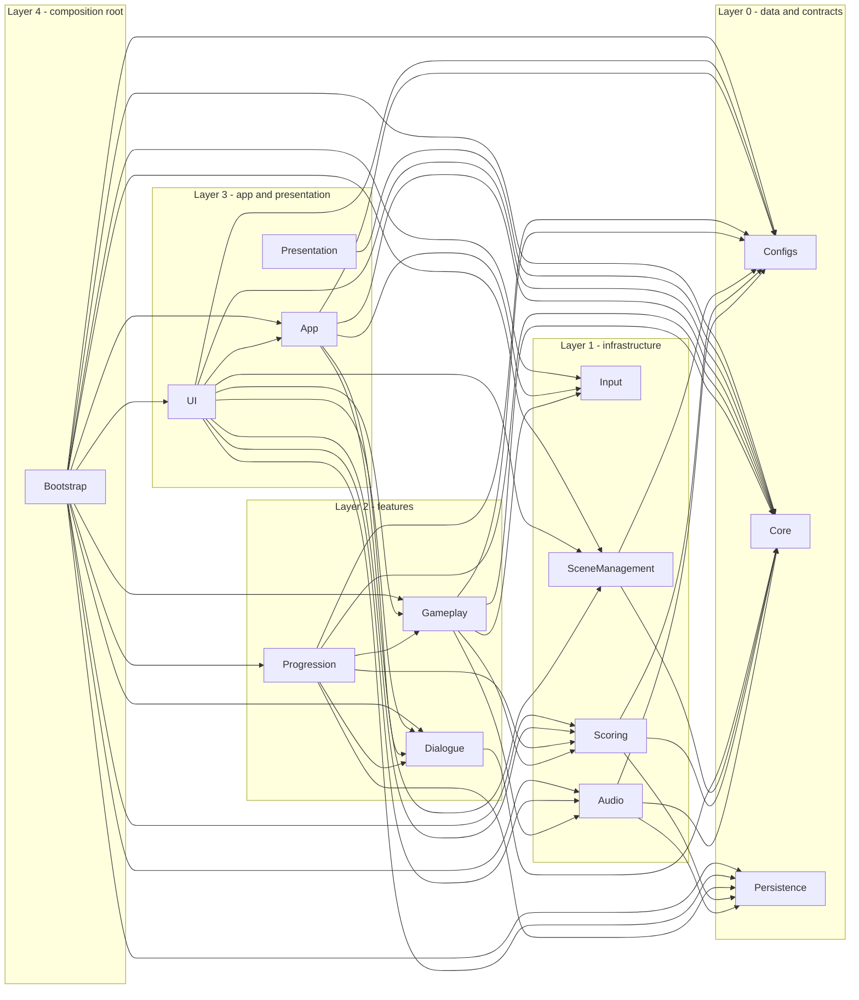
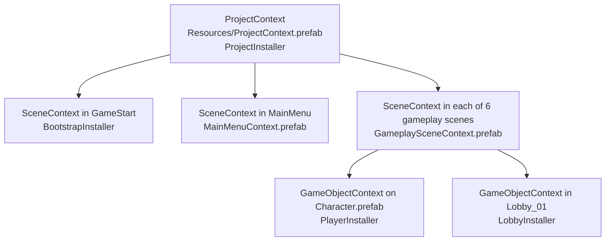
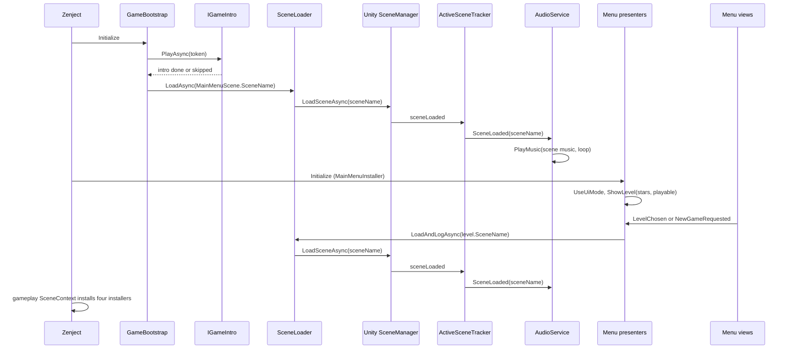
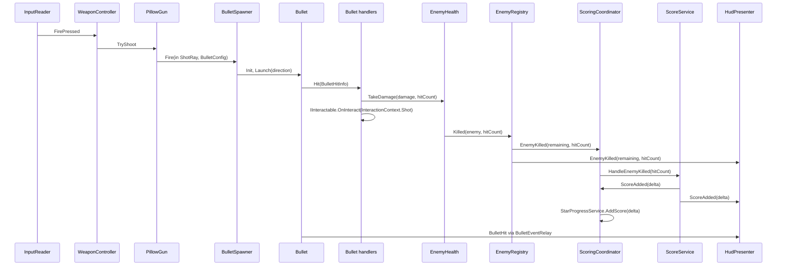
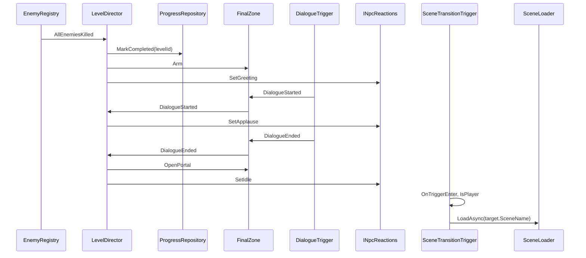
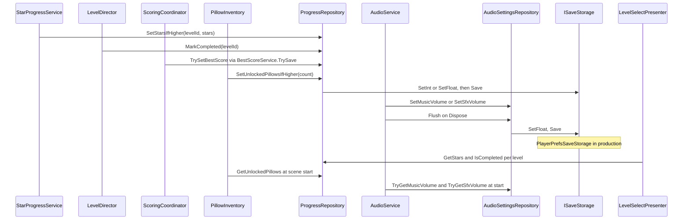

# Architecture

The deep dive behind the [root README](../README.md). It describes the code as it is today. The "why" of each decision lives in the [ADRs](adr/README.md); this page links to them and does not retell them.

Contents: [Assembly graph](#assembly-graph) · [Composition root](#composition-root) · [Core flows](#core-flows) · [Cross-cutting rules](#cross-cutting-rules) · [Conventions enforced by tests](#conventions-enforced-by-tests) · [Module deep dives](#module-deep-dives)

## Assembly graph

14 runtime assemblies, one per folder under [`Assets/_Project/Scripts`](../Assets/_Project/Scripts). Edges are project-to-project references read off the `.asmdef` files (checked again on 2026-11-09). An arrow means "references". Everything points from a feature toward the infrastructure it needs.

### Layering rules the compiler enforces

An assembly can only see what its `.asmdef` lists, so these are compile errors, not review comments.

1. **Layer 0 is a leaf.** `Configs` and `Persistence` reference no package or project assembly. `Core` references only `UniTask`.
2. **Nothing points back up.** `Gameplay` cannot see `UI`, `App`, `Progression` or `Persistence`. `Dialogue` sees only `Core`. `Scoring` cannot see `Gameplay`, which is why `ScoringCoordinator` lives in `Progression`, the one place that joins the two.
3. **Only `Bootstrap` knows everything.** No assembly references `Bootstrap`, and it is the only one with `autoReferenced: true`.
4. **Only `Presentation` links the render pipeline.** The damage vignette listens to `IPlayerDamageState` from `Core`, so `Gameplay` stays free of URP.

When the consumer sits below the implementer, the contract lives in `Core` (`ILevelCompletion`, `IPauseState`, `IActiveSceneTracker`, the player seams). Every other interface lives in the module that owns the concept. Details and the history of dropped edges: [ADR 0002](adr/0002-assembly-layering.md).

### Package references

Beyond `Zenject` and `UniTask`, packages are referenced only where the code uses them.

| Package | Referenced by | Used for |
|---|---|---|
| `Zenject` | `App`, `Audio`, `Bootstrap`, `Dialogue`, `Gameplay`, `Presentation`, `Progression`, `SceneManagement`, `UI` | `[Inject]`, `IInitializable`, installers |
| `UniTask` | `App`, `Bootstrap`, `Core`, `Dialogue`, `Gameplay`, `Presentation`, `Progression`, `SceneManagement`, `UI` | cancellable async, [ADR 0006](adr/0006-unitask-lifetimes.md) |
| `Unity.InputSystem` | `Input`, `Dialogue`, `UI` | `InputReader`; the dialogue "Next" action; the intro skip |
| `Unity.Cinemachine` | `Dialogue`, `Gameplay` | camera priority during dialogue; the player camera |
| `Unity.Localization` | `Dialogue`, `UI` | text lookup; the locale selector |
| `Unity.TextMeshPro`, `UnityEngine.UI` | `UI` (`UnityEngine.UI` also `Gameplay`) | views |
| `Unity.VisualEffectGraph.Runtime` | `Gameplay` | effects |
| `Unity.RenderPipelines.*` | `Presentation` | the damage vignette |

Gameplay input goes through `IPlayerInput` in `Input`. The dialogue and UI controls read their own actions directly, a deliberate exception recorded in ADR 0002.

## Composition root

Zenject builds three kinds of container. Each one is the child of the one above it, so a binding is visible downward and never upward.

- **ProjectContext** is created by Zenject from [`Resources/ProjectContext.prefab`](../Assets/_Project/Resources/ProjectContext.prefab) before the first scene. It carries `ProjectInstaller` only. Its services live for the whole run, so no `DontDestroyOnLoad` is needed.
- **SceneContext** exists once per scene and dies with it. Three placements: `GameStart` has a scene-placed context with `BootstrapInstaller`; the menu carries [`MainMenuContext.prefab`](../Assets/_Project/Prefabs/Bootstrap/MainMenuContext.prefab); every gameplay scene carries the same [`GameplaySceneContext.prefab`](../Assets/_Project/Prefabs/Bootstrap/GameplaySceneContext.prefab), which holds four installers and a `DialogueInputHandler` component that needs the same container. One prefab means no snowflake scenes ([ADR 0001](adr/0001-zenject-composition-root.md)).
- **GameObjectContext** composes one object. Only two exist: on `Character.prefab` (the player, [ADR 0001](adr/0001-zenject-composition-root.md) and the README), and one placed in `Lobby_01` for the lobby scenario. No enemy or other prefab has one: enemies are plain components that the scene container finds. This was read from the prefab and scene YAML (`m_Script` guid to `.cs.meta`), not from the ADRs.

### Installers

All installers except `PlayerInstaller` and `LobbyInstaller` live in [`Bootstrap`](../Assets/_Project/Scripts/Bootstrap). The table lists what each `InstallBindings` does today.

| Installer | Host and scope | Binds |
|---|---|---|
| [`ProjectInstaller`](../Assets/_Project/Scripts/Bootstrap/ProjectInstaller.cs) | `ProjectContext`, app lifetime | `SceneCatalog`, `AudioConfig` instances. `AudioPlayer` (new prefab, non-lazy) as its interfaces (`IAudioOutput`). `AudioService` (non-lazy). `ISceneLoadingBackend` to `UnitySceneLoadingBackend`, `SceneLoader`, `UnityActiveSceneTracker`. `PlayerPrefsSaveStorage`, `ProgressRepository`, `AudioSettingsRepository`. `CursorService`, `UnityApplicationQuitter`, `FrameRateLimiter`. All `BindInterfacesTo<T>().AsSingle()` |
| [`BootstrapInstaller`](../Assets/_Project/Scripts/Bootstrap/BootstrapInstaller.cs) | `GameStart` scene context | `IGameIntro` to `GameStartUI` (`FromComponentInHierarchy`, lazy). `GameBootstrap` as its interfaces |
| [`MainMenuInstaller`](../Assets/_Project/Scripts/Bootstrap/MainMenuInstaller.cs) | `MainMenuContext.prefab` | `IMainMenuView`, `ILevelSelectView`, `IAudioSettingsView` to their views (`FromComponentInHierarchy`). `LocalizationLocaleSelector`, `MainMenuPresenter`, `LevelSelectPresenter`, `AudioSettingsPresenter` |
| [`SceneServicesInstaller`](../Assets/_Project/Scripts/Bootstrap/SceneServicesInstaller.cs) | `GameplaySceneContext.prefab` | Player parts the scene needs to see, `FromComponentInHierarchy`: `PlayerCharacter`, `PlayerInputSwitch`, `PillowLauncher`, `IPlayerDamageState` to `PlayerDamageReceiver`, `GameInput` (menu input). Plain classes: `UnityLocalizedTextProvider`, `DialogueService`, `PauseService`, `GameFlowService`, `InGameMenuController` |
| [`CombatInstaller`](../Assets/_Project/Scripts/Bootstrap/CombatInstaller.cs) | `GameplaySceneContext.prefab` | `BulletSpawner` (as `IBulletSpawner` and itself) from one prefab instance, non-lazy. `IBulletHitSource` from its `HitRelay`. A memory pool of `EnemyProjectile` (initial size 8). The enemy roster and `EnemyRegistry`, see below |
| [`ProgressionInstaller`](../Assets/_Project/Scripts/Bootstrap/ProgressionInstaller.cs) | `GameplaySceneContext.prefab` | This scene's `LevelDefinition` and its `StarRules`, `ScoreRules` as instances. `ScoreService`, `StarProgressService`, `BestScoreService`, `ScoringCoordinator`, `PillowInventory`, `LevelDirector`. `ILevelCast` to `LevelActors` (`FromComponentInHierarchy`) |
| [`UiInstaller`](../Assets/_Project/Scripts/Bootstrap/UiInstaller.cs) | `GameplaySceneContext.prefab` | `IGameHudView` to `GameUIRoot` and `IDialogueView` to `DialogueView`, each from a new prefab. `IPauseMenuView` and `IAudioSettingsView` from the scene. `HudPresenter`, `DialoguePresenter`, `PauseMenuPresenter`, `AudioSettingsPresenter` |
| [`PlayerInstaller`](../Assets/_Project/Scripts/Gameplay/Player/PlayerInstaller.cs) | `GameObjectContext` on `Character.prefab` | `PlayerConfig`. `InputReader` (as `IPlayerInput` and itself), `CharacterController`, `Transform`, `GroundSurfaceSensor`, `IActorAudio` from the root. `Camera.main`. Cinemachine parts and `Animator` from the prefab subtree. Plain classes: `PlayerMovement`, `PlayerGravity`, `PlayerLook`, `PlayerKnockback`, `SafePositionTracker`, `PlayerJump`, `PlayerHealth`, `PlayerMotor`, `PlayerAnimatorDriver`. `PillowGun`, `WeaponController`, `ISphereCaster` to `PhysicsSphereCaster`. Throws when `PlayerConfig` is missing |
| [`LobbyInstaller`](../Assets/_Project/Scripts/Progression/Lobby/LobbyInstaller.cs) | `GameObjectContext` in `Lobby_01` | `ILobbyCast` from the `LobbyActors` beside it, `LobbyDirector`. Throws when the cast has a missing reference |

Rules that hold in every installer: services are bound by interface; plain classes take constructor injection and MonoBehaviours take `[Inject] Construct(...)`; a plain class with `IInitializable`/`IDisposable` replaces `Start`/`OnDestroy`.

### Fail-fast and the enemy roster

- **`ProgressionInstaller` throws** `InvalidOperationException` when the running scene has no `LevelDefinition` in the `SceneCatalog` (line 27). It gets the catalog by `[Inject]` from the project context, so there is one catalog and no second serialized copy. A scene that is missing from the catalog fails at container build, not later as an unrelated resolve error. `SceneCompositionTests.GameplayScene_ProgressionInstallerResolvesItsLevel` checks the same thing for every build scene without playing it.
- **`EnemyRegistry` is a plain class** whose roster the container builds. `CombatInstaller` binds `EnemyHealth` with `FromComponentsInHierarchy(includeInactive: true).AsCached().WhenInjectedInto<EnemyRegistry>()`, so the registry gets every enemy in the scene, including those waiting for a wave, as a constructor argument. It exists before any `Initialize` runs, so subscribers read current state regardless of order. The binding applies only when injecting into `EnemyRegistry`, so no other class can accidentally receive the list.

## Core flows

Each diagram uses real type, method and event names. Participant names are short on purpose.

### a. Bootstrap, main menu, level

[`GameBootstrap`](../Assets/_Project/Scripts/Bootstrap/GameBootstrap.cs) is the only place that knows the startup order. A failing intro is logged and the menu still loads. [`SceneLoader`](../Assets/_Project/Scripts/SceneManagement/SceneLoader.cs) owns one transition at a time: a request during a load is ignored, not queued. Presenters call [`LoadAndLogAsync`](../Assets/_Project/Scripts/SceneManagement/SceneLoaderExtensions.cs) because they have nobody to report to: cancellation is silent, any other failure is logged.

[`AudioService`](../Assets/_Project/Scripts/Audio/AudioService.cs) never touches `SceneManager`. It listens to `IActiveSceneTracker` and plays the clip the catalog assigns to the scene. A scene without a clip means silence, a scene missing from the catalog keeps the current music and logs a warning. [`LevelSelectPresenter`](../Assets/_Project/Scripts/UI/Menus/LevelSelectPresenter.cs) re-checks that a level is playable on every click. A new game always loads the first catalog level ([`MainMenuPresenter`](../Assets/_Project/Scripts/UI/Menus/MainMenuPresenter.cs)). Scene names come only from `SceneCatalog` ([ADR 0004](adr/0004-scene-catalog-and-async.md)).

### b. Shooting pipeline

Input is a Zenject-built chain of small types. `InputReader` (on the player root, bound as `IPlayerInput`) raises `FirePressed`; [`WeaponController`](../Assets/_Project/Scripts/Gameplay/Weapons/WeaponController.cs) forwards it to `IWeapon.TryShoot`; [`PillowGun`](../Assets/_Project/Scripts/Gameplay/Weapons/PillowGun.cs) checks its cooldown and calls `IBulletSpawner.Fire`. The aim preview reads the same `ShotRay` and `BulletConfig`, so the preview bounces exactly as often as the bullet; its length is an upper bound (see [aim and ricochet](modules/aim-and-ricochet.md)).

A [`Bullet`](../Assets/_Project/Scripts/Gameplay/Weapons/Bullets/Bullet.cs) raises `Hit` on every collision through `IsolatedEvent`. Three listeners, none aware of the others: `BulletDamageHandler` applies damage to an `IDamageable`, `BulletInteractionHandler` sends `InteractionContext.Shot` to an `IInteractable` ([ADR 0005](adr/0005-interaction-effects-as-components.md)), and `BulletEventRelay` forwards to `IBulletHitSource.BulletHit`, which the HUD turns into ricochet badges. The bullet returns to its pool after `MaxCollisionCount` hits or when its lifetime ends.

A kill goes `EnemyHealth.Killed` to `EnemyRegistry` to its two listeners. [`ScoringCoordinator`](../Assets/_Project/Scripts/Progression/ScoringCoordinator.cs) owns the rules: score per kill, every score feeds the star meter. [`HudPresenter`](../Assets/_Project/Scripts/UI/Hud/HudPresenter.cs) holds no rules and only shows results ([ADR 0007](adr/0007-hud-mvp.md)): it also shows `StarProgressChanged` and `StarUnlocked` from `StarProgressService`, which saves the star count as it goes (flow d). The throw and recall of pillows is a second path: `InputReader` raises `ThrowPressed`, [`PillowLauncher`](../Assets/_Project/Scripts/Gameplay/Weapons/Pillows/PillowLauncher.cs) asks `PillowRack.ThrowOrRecall`, and a recall runs as a cancellable loop calling `PillowRack.StepReturn` each frame. The rules are in the plain class [`PillowRack`](../Assets/_Project/Scripts/Gameplay/Weapons/Pillows/PillowRack.cs).

### c. Level completion

[`LevelDirector`](../Assets/_Project/Scripts/Progression/LevelDirector.cs) is the whole scenario in one plain class: no `Update` polling, and the zone, dialogue and NPC do not know about each other. The order matters. When the final dialogue ends, the director opens the portal first and only then tells the NPC to idle, so a failing NPC reaction can never block the way onward. `LevelDirectorTests.FinalDialogueEnded_WhenTheNpcThrows_StillOpensThePortal` pins it. A level with a final zone but no enemies counts as won on the first frame (`CompleteAfterSceneStartAsync`), after the NPCs have run their own `Start`.

Note that `SceneTransitionTrigger` does not mark every exit as a completion. In an enemy level `LevelDirector` saves the level as completed when the last enemy dies, before the finale. The trigger calls `ILevelCompletion.CompleteLevel` only when its `_completesLevel` flag is set, for hubs such as a lobby exit portal. `LevelDirector` implements `ILevelCompletion` for that case; `SceneManagement` sees only the `Core` interface ([ADR 0002](adr/0002-assembly-layering.md)). `SceneCompositionTests.GameplayScene_CanBeCompleted` requires every gameplay scene to have an armable `FinalZone` or a completing portal.

Lobbies run a second, separate scenario. [`LobbyDirector`](../Assets/_Project/Scripts/Progression/Lobby/LobbyDirector.cs) (built by the `GameObjectContext` in `Lobby_01`) holds two [`KillGroupObjective`](../Assets/_Project/Scripts/Progression/Objectives/KillGroupObjective.cs)s: the first dialogue opens the first `IDoor`, clearing group one arms the second dialogue, clearing group two opens the second door. It does not mark progress; that is the exit portal's `_completesLevel`.

### d. Save and load

Every save goes through [`ISaveStorage`](../Assets/_Project/Scripts/Persistence/ISaveStorage.cs), implemented in production by `PlayerPrefsSaveStorage` and in tests by `InMemorySaveStorage`. It is the only code allowed to touch a storage API. Two repositories sit on top: [`ProgressRepository`](../Assets/_Project/Scripts/Persistence/ProgressRepository.cs) (stars, completed flag, best score, unlocked pillows) and [`AudioSettingsRepository`](../Assets/_Project/Scripts/Persistence/AudioSettingsRepository.cs) (two volumes). Key formats are frozen in [`SaveKeys`](../Assets/_Project/Scripts/Persistence/SaveKeys.cs): a changed key silently wipes existing progress ([ADR 0003](adr/0003-persistence-abstraction.md)).

Writes only ever raise a value: stars, best score and unlocked pillows use "if higher" methods, so a worse replay never regresses a save. `ProgressRepository` saves on each write. `AudioService` writes slider values to the repository on every change and flushes to disk once on `Dispose`. Pillow unlocks come from `PillowRewardOnDialogue` calling `IPillowInventory.UnlockUpTo` when a dialogue ends. A save written before unlocks existed is seeded once from the completed levels.

Reads: at menu time `LevelSelectPresenter` reads stars and the completed flag for every level and decides which buttons are playable. `AudioService` reads both volumes when the project context starts, so the saved volume is applied before the first scene's music. `PillowInventory` reads the unlock count when a gameplay scene is built.

## Cross-cutting rules

### Fault isolation

Shared events are raised through [`IsolatedEvent.Raise`](../Assets/_Project/Scripts/Core/Events/IsolatedEvent.cs), which invokes each listener on its own: one that throws is logged and the rest still run. It is used where several independent listeners hear one event and a single failure must not stall a game flow:

| Event | Raised in |
|---|---|
| `Bullet.Hit` | `Bullet` |
| `EnemyHealth.Killed`, `Died` | `EnemyHealth` |
| `EnemyKilled`, `AllEnemiesKilled` | `EnemyRegistry` |
| `ScoreAdded` | `ScoreService` |
| `DialogueStarted`, `DialogueEnded` | `DialogueTrigger` |
| `ActiveChanged` | `DialogueService` |
| `ProgressChanged` | `SceneLoader` |

[`EffectChain`](../Assets/_Project/Scripts/Gameplay/Interactables/EffectChain.cs) isolates the effects of one interactable with its own `try`/`catch`. `IsolatedEventTests` covers the helper itself.

### Pause owns time and control

`IPauseService` (in `App`) extends the read-only `IPauseState` (in `Core`). While the pause menu is open it alone decides time and control:

- [`PauseService`](../Assets/_Project/Scripts/App/PauseService.cs) sets `Time.timeScale` to 0, disables player control and switches the cursor to UI mode. `Resume` reverses all three. Its `Dispose` sets `timeScale` back to 1, so a scene never hands a frozen clock to the next one.
- [`InGameMenuController`](../Assets/_Project/Scripts/App/InGameMenuController.cs) listens to `IDialogueState.ActiveChanged`. A dialogue that ends while the menu is open hands nothing back (`if (_pause.IsPaused) return`). Closing the menu restores time, and keeps player control off if a dialogue is still active.
- `DialogueInputHandler` ignores "Next" while `IPauseState.IsPaused`. This is why `IPauseState` is in `Core`: `Dialogue` cannot see `App`.

### Async

Timed logic is UniTask with an explicit `CancellationToken`, never a coroutine. The helpers are in [`Core/Async`](../Assets/_Project/Scripts/Core/Async):

- `GameTime` waits in scaled time, so pause freezes it. Every wait yields at least one frame.
- `Tween.RunAsync` is frame-driven interpolation in scaled time.
- `Cancellation` holds the cancel, dispose, clear sequence for restartable operations.

Two lifetime models decide where the token comes from. A one-shot sequence takes the token from its owner's destruction (`GetCancellationTokenOnDestroy`). An endless loop follows `OnEnable`/`OnDisable`. Plain classes own a `CancellationTokenSource` cancelled in `Dispose`, as `GameBootstrap` does. Full reasoning: [ADR 0006](adr/0006-unitask-lifetimes.md) and [ADR 0004](adr/0004-scene-catalog-and-async.md).

## Conventions enforced by tests

Style is checked, not reviewed. The tests live under [`Assets/_Project/Tests/EditMode`](../Assets/_Project/Tests/EditMode).

| Rule | Test that enforces it |
|---|---|
| Code, comments and logs are English | [`CodeConventionsTests.Scripts_ContainNoCyrillic`](../Assets/_Project/Tests/EditMode/Architecture/CodeConventionsTests.cs) |
| Every public type has an XML summary | `CodeConventionsTests.PublicTypes_HaveXmlSummaries` |
| A concrete class nobody derives from is `sealed` | `CodeConventionsTests.ConcreteClasses_WithoutSubclasses_AreSealed` |
| No public instance fields, `_camelCase` private fields, `[SerializeField]` only on private fields, events without `On` prefix, no `Manager` suffix | [`NamingConventionsTests`](../Assets/_Project/Tests/EditMode/Architecture/NamingConventionsTests.cs), read from the compiled types by reflection |
| No coroutine API, no string `Invoke` | [`CoroutineGuardTests`](../Assets/_Project/Tests/EditMode/Architecture/CoroutineGuardTests.cs) (the allow-list is empty) |
| A renamed serialized field leaves no data under its old name and no attribute behind | [`SerializedDataHygieneTests`](../Assets/_Project/Tests/EditMode/Architecture/SerializedDataHygieneTests.cs) over [`RetiredSerializedFields`](../Assets/_Project/Tests/EditMode/Architecture/RetiredSerializedFields.cs), plus `NamingConventionsTests.Fields_CarryNoFormerlySerializedAs` ([ADR 0010](adr/0010-renaming-serialized-fields.md)) |
| Every build scene has one `SceneContext`, the installers its role needs, resolvable `FromComponentInHierarchy` targets, no missing scripts, and a way to be completed | [`SceneCompositionTests`](../Assets/_Project/Tests/EditMode/Composition/SceneCompositionTests.cs) |
| No prefab has a missing script | [`PrefabIntegrityTests`](../Assets/_Project/Tests/EditMode/Composition/PrefabIntegrityTests.cs) |
| The player prefab keeps its `GameObjectContext` and config | [`PlayerPrefabTests`](../Assets/_Project/Tests/EditMode/Player/PlayerPrefabTests.cs) |
| Every script in every prefab and scene has the components its `[RequireComponent]` names | [`RequiredComponentsContentTests`](../Assets/_Project/Tests/EditMode/Architecture/RequiredComponentsContentTests.cs) |
| Every menu button does something and every Inspector call resolves | [`MenuWiringTests`](../Assets/_Project/Tests/EditMode/UI/MenuWiringTests.cs) |
| Enemy tuning and archetype never change by accident | [`EnemyTuningSnapshotTests`](../Assets/_Project/Tests/EditMode/Enemies/EnemyTuningSnapshotTests.cs) against `EnemyTuningSnapshot.tsv`; [`EnemyContentTests`](../Assets/_Project/Tests/EditMode/Enemies/EnemyContentTests.cs) ([ADR 0011](adr/0011-enemy-archetypes.md)) |
| No dialogue line is lost or changed | [`DialogueContentTests`](../Assets/_Project/Tests/EditMode/Dialogue/DialogueContentTests.cs) against `DialogueSnapshot.tsv` ([ADR 0009](adr/0009-data-driven-dialogues.md)) |
| Screen hints keep target, timing and text | [`ProximityHintContentTests`](../Assets/_Project/Tests/EditMode/UI/ProximityHintContentTests.cs) |
| Star thresholds are positive and ascending; weapon configs stay in sync with the aim preview | [`StarRulesContentTests`](../Assets/_Project/Tests/EditMode/Scoring/StarRulesContentTests.cs), [`WeaponConfigContentTests`](../Assets/_Project/Tests/EditMode/Weapons/WeaponConfigContentTests.cs) |
| Lobby scenario and pillow unlocks ship as designed | [`LobbyContentTests`](../Assets/_Project/Tests/EditMode/Progression/LobbyContentTests.cs), [`PillowUnlockContentTests`](../Assets/_Project/Tests/EditMode/Progression/PillowUnlockContentTests.cs) |
| A throwing listener cannot stop the others; the portal opens even if the NPC fails | [`IsolatedEventTests`](../Assets/_Project/Tests/EditMode/Core/IsolatedEventTests.cs), [`LevelDirectorTests`](../Assets/_Project/Tests/EditMode/Progression/LevelDirectorTests.cs) |

Not enforced by a test: the assembly layering. The compiler does that (see [Assembly graph](#assembly-graph)).

## Module deep dives

- [Enemy state machine](modules/enemy-state-machine.md): the guarded FSM, `IEnemyContext` and the `EnemyConfig` archetypes.
- [Aim and ricochet](modules/aim-and-ricochet.md): `ShotRay`, `BouncePath` and the `ISphereCaster` seam behind the aim preview.
