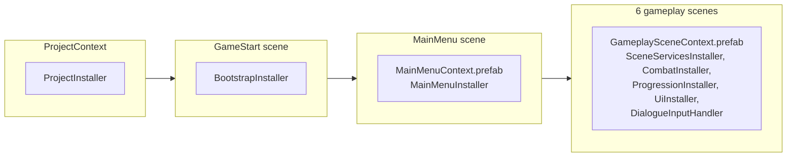

# 0001. Zenject composition root

Status: Accepted
Date: 2026-09-12

## Context

DreamVille needs one place that wires plain C# services to Unity objects across eight scenes (one bootstrap scene, one menu, six gameplay scenes) without every MonoBehaviour reaching for `FindObjectOfType` or a hand-rolled singleton. Before the refactor, four of the six gameplay scenes had no scene-level composition at all, and the two that did each wired their own `SceneContext`/installer set — so "does this scene have pause, dialogue, a menu" depended on which scene it happened to be, and a copy-paste mistake in one installer would not show up until that specific scene ran.

## Decision

Use Zenject/Extenject as the composition root, with three fixed entry points and nothing else:

- **ProjectContext**, installed by [`ProjectInstaller`](../../Assets/_Project/Scripts/Bootstrap/ProjectInstaller.cs): app-lifetime services that outlive a scene — `SceneCatalog`, `AudioConfig`, the `AudioPlayer` prefab and `AudioService`, `ISceneLoader`, and the three persistence bindings (`ISaveStorage`, `IProgressRepository`, `IAudioSettingsRepository`), and the application-level services `ICursorService` (`CursorService`), `IApplicationQuitter` (`UnityApplicationQuitter`) and `FrameRateLimiter`.
- One [`GameplaySceneContext.prefab`](../../Assets/_Project/Prefabs/Bootstrap/GameplaySceneContext.prefab) shared by all six gameplay scenes, carrying a `SceneContext` with four `MonoInstaller`s in a fixed order — [`SceneServicesInstaller`](../../Assets/_Project/Scripts/Bootstrap/SceneServicesInstaller.cs), [`CombatInstaller`](../../Assets/_Project/Scripts/Bootstrap/CombatInstaller.cs), [`ProgressionInstaller`](../../Assets/_Project/Scripts/Bootstrap/ProgressionInstaller.cs), [`UiInstaller`](../../Assets/_Project/Scripts/Bootstrap/UiInstaller.cs) — plus a `DialogueInputHandler` component that is not an installer but needs the same container.
- [`MainMenuContext.prefab`](../../Assets/_Project/Prefabs/Bootstrap/MainMenuContext.prefab) for the menu scene, with [`MainMenuInstaller`](../../Assets/_Project/Scripts/Bootstrap/MainMenuInstaller.cs), which binds the menu, level-select and audio-settings views and presenters and the locale selector ([ADR 0008](0008-menus-mvp.md)). It was an empty placeholder until then; even empty, it gave the scene a *declared* composition to test against, instead of "whatever prefab was dropped there".
- [`BootstrapInstaller`](../../Assets/_Project/Scripts/Bootstrap/BootstrapInstaller.cs) in the `GameStart` scene, which binds only the intro UI and [`GameBootstrap`](../../Assets/_Project/Scripts/Bootstrap/GameBootstrap.cs) — the class that plays the intro and then loads the menu scene named by `SceneCatalog`.

Rules that hold across every installer:

- Services are bound by interface — `Container.BindInterfacesTo<T>()` — so consumers depend on `IScoreService`, `IPillowThrower`, `IEnemyRegistry`, never on the concrete type. [`HudPresenter`](../../Assets/_Project/Scripts/UI/Hud/HudPresenter.cs) takes six constructor arguments and all six are interfaces.
- Plain C# services (`PauseService`, `GameFlowService`, `ScoreService`, `AudioService`, ...) take dependencies through the constructor; MonoBehaviours use `[Inject] Construct(...)`.
- `IInitializable`/`IDisposable` replace `Start`/`OnDestroy` for container-owned services. `InGameMenuController`, `HudPresenter`, `ScoringCoordinator`, `LevelDirector`, `GameBootstrap` and `AudioService` are plain classes, not MonoBehaviours, precisely so their lifetime is Zenject's rather than Unity's.
- A MonoBehaviour survives in the graph only as a scene facade with no substitute: `PlayerContext` (13 gameplay consumers; since 2026-09-25 the thin `PlayerCharacter` marker, with the player's own systems composed by a `GameObjectContext` + `PlayerInstaller`), `LevelActors` (a list of scene references), `GameUIRoot` and `DialogueView` (view facades, the latter instantiated from a prefab and bound as `IDialogueView`), `BulletPool`/`GameInput`/`GameStartUI` (single-consumer engine adapters). None of them is unit-tested; that is deliberate — the plain classes wrapped around them are.
- [`SceneCompositionTests`](../../Assets/_Project/Tests/EditMode/Composition/SceneCompositionTests.cs) opens every enabled build scene and asserts it has exactly one `SceneContext`, the installer set its role requires, and the `FromComponentInHierarchy` targets those installers expect. Every gameplay scene must also have a dialogue prefab on its `UiInstaller` and exactly one `EventSystem`. It is the regression guard for "one prefab, no snowflake scenes".

## Consequences

- Adding a seventh gameplay scene means dropping in one prefab, not re-deriving which of four installers it needs; `SceneCompositionTests` fails loudly if one is missing.
- `HudPresenter` depends only on interfaces (its view is bound as `IGameHudView`), so the HUD wiring is tested with fakes instead of a live scene. The scoring rules live in `ScoringCoordinator` (bound in `ProgressionInstaller`); `UiInstaller` binds the HUD view and its presenter together, plus the pause menu and audio settings views and presenters ([ADR 0008](0008-menus-mvp.md)); `InGameMenuController` takes `IMenuInput`, not the concrete `GameInput`. See [ADR 0007](0007-hud-mvp.md). `GameplayInstaller` was removed once it had nothing left to bind.
- Dialogues are composed from the same pieces ([ADR 0009](0009-data-driven-dialogues.md)). `SceneServicesInstaller` binds two plain classes, `UnityLocalizedTextProvider` and `DialogueService`. `UiInstaller` binds `IDialogueView` with `FromComponentInNewPrefab` (a `[SerializeField] DialogueView _dialoguePrefab`, like the HUD) and `DialoguePresenter` next to it. The `DialogueManager` host MonoBehaviour and its `FromComponentInHierarchy` binding are gone.
- The four `Scenes/Max/*` work-in-progress scenes still reference the older `Prefabs/Bootstrap/SceneContext.prefab` and are excluded from Build Settings and from `SceneCompositionTests`; promoting one of them requires moving it onto `GameplaySceneContext.prefab` first.
- `[InjectOptional]` is gone from the call sites that used to fall back to a `Debug.LogWarning`; a scene that forgets an installer now fails at container-build time instead of logging and continuing.

## Alternatives considered

- **Manual entry-point MonoBehaviour** (the pre-refactor `GameplaySceneEntryPoint`, since deleted with the rest of `_Legacy`): a single `Awake`/`Start` that constructed every system by hand. Rejected — it does not scale past one scene without copy-paste, and nothing in it is fakeable for a test.
- **Service locator / static singletons**: a `*.Instance`-style static accessor, the shape the old audio manager used before this refactor. Rejected — it hides the dependency graph, and the project's conventions forbid static service access outright.
- **VContainer**: a lighter, source-generator-based DI container. Rejected for this project because Zenject/Extenject was already the installed package and the goal of this step was to fix the composition, not migrate frameworks; VContainer remains a fair choice for a project starting from zero.
