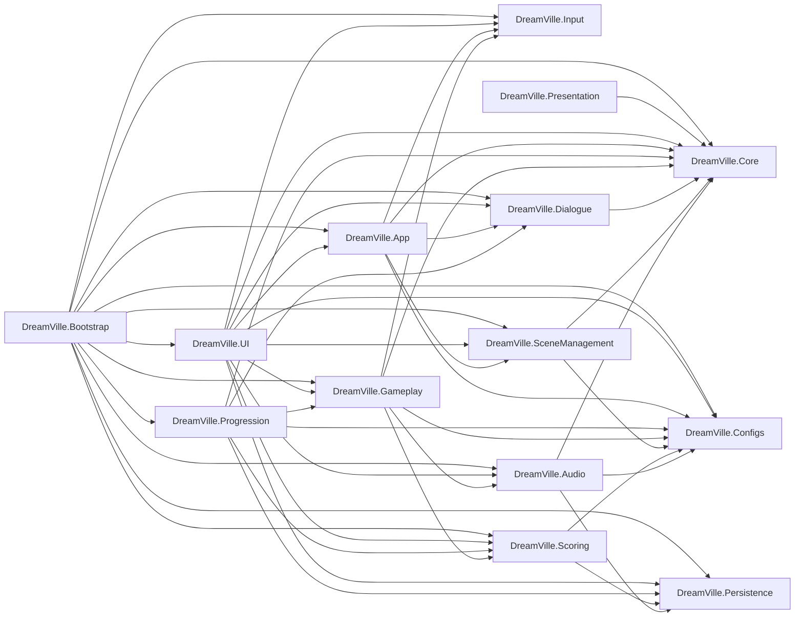

# 0002. Assembly layering

Status: Accepted
Date: 2026-09-12

## Context

Before this step the assembly graph pointed both ways: `DreamVille.Core` held `PauseService` and `InGameMenuController`, which referenced `DreamVille.Gameplay` and `DreamVille.Dialogue` just to answer "is this collider the player" and "is a dialogue running"; `DreamVille.SceneManagement` and `DreamVille.Dialogue` each referenced `DreamVille.Gameplay` for the same question, with three different concrete lookups (`PlayerSafePosition`, `PlayerContext`, `PlayerDetectorTrigger`). Namespaces had also drifted from folders — `Core/Input` compiled into assembly `DreamVille.Input` under namespace `DreamVille.Core.Input`. None of this was a compiler error, because Unity resolves an asmdef graph as long as it is acyclic at the file level, but it meant "what can `Core` see" was not something the folder tree could answer on its own.

## Decision

Layer the fourteen script assemblies so every reference points from a feature toward the infrastructure it needs, never back. The graph below is read directly off the current `.asmdef` files under [`Assets/_Project/Scripts`](../../Assets/_Project/Scripts) — DreamVille-to-DreamVille edges only; every assembly also references whatever Unity/Zenject/UniTask packages it needs.

`Configs`, `Core` and `Persistence` reference no other DreamVille assembly; `Input` adds only `Unity.InputSystem`. Nothing below them is needed yet.

Supporting rules, all verified in the current tree:

- `DreamVille.Core` is a handful of interfaces and one static helper — [`IActiveSceneTracker`](../../Assets/_Project/Scripts/Core/Scenes/IActiveSceneTracker.cs) (the active-scene seam `Audio` listens to instead of `SceneManager`), [`ILevelCompletion`](../../Assets/_Project/Scripts/Core/Scenes/ILevelCompletion.cs), [`IPlayerMarker`](../../Assets/_Project/Scripts/Core/Players/IPlayerMarker.cs), [`IPlayerControlSwitch`](../../Assets/_Project/Scripts/Core/Players/IPlayerControlSwitch.cs), [`IPlayerZone`](../../Assets/_Project/Scripts/Core/Players/IPlayerZone.cs), [`PlayerDetection`](../../Assets/_Project/Scripts/Core/Players/PlayerDetection.cs) — and nothing else.
- Interfaces live in the module that owns the concept, not in `Core`: `IScoreService`/`IStarProgressService`/`IBestScoreService` in `Scoring`, `ISceneLoader` in `SceneManagement`, `IDialogueService`/`IDialogueState` in `Dialogue`, `IAudioService`/`IAudioSettings`/`IAudioOutput` in `Audio`, `IEnemyRegistry`/`IBulletSpawner`/`IBulletHitSource`/`IPillowThrower`/`IWeapon` in `Gameplay`, `ICursorService`/`IPauseService`/`IGameFlowService`/`IInGameMenu` in `App`. `Core` only holds a contract when the *consumer* sits below the *implementer* in the graph — the player-detection seams are the one case where that happens today (implemented by `PlayerCharacter`, `PlayerInputSwitch`, `PlayerDetectorTrigger` in `Gameplay`; consumed by `SceneManagement`, `Dialogue` and `UI`, all of which sit below or beside `Gameplay`).
- `DreamVille.Dialogue` references no DreamVille assembly but `Core`. Since the data-driven dialogues ([ADR 0009](0009-data-driven-dialogues.md)) it also references the `UniTask` package (`DialogueService`, `UnityLocalizedTextProvider`) and `Unity.ResourceManager`, the Localization package's own dependency, only to name `AsyncOperationHandle<string>` in `UnityLocalizedTextProvider`.
- `autoReferenced` is `false` on every DreamVille assembly except `DreamVille.Bootstrap`; a script placed outside an asmdef folder cannot silently see the whole project.
- Namespace equals assembly name for every module (`rootNamespace` matches the asmdef `name`); the one nested case, `DreamVille.Core.Players`, is a folder inside `Core`, not a separate assembly.
- The graph is leaner than first drafted, by design: a planned `Input → Core` edge and a planned `Dialogue → Configs` edge were both dropped in a review pass because neither module's code used anything from the other assembly — the edge was pure risk with no payoff. A planned `UI → Scoring` edge was dropped the same way at first, while `GameplayPresenter` in `Bootstrap` was the only reader of `IScoreService`. It came back with the HUD MVP: `HudPresenter` now lives in `UI` next to its views and needs `IScoreService` and `IStarProgressService` events ([ADR 0007](0007-hud-mvp.md)).

## Consequences

- `DreamVille.Presentation` (added with the player composition, 2026-09-25) is the only assembly that references the render pipeline: the damage vignette listens to `IPlayerDamageState` from `Core`, so `Gameplay` no longer links URP. Nothing references `Presentation`; its component sits on the scene's `Global Volume` and is injected by the scene context.
- The compiler enforces the layering; a future `Gameplay` change that reaches for `DreamVille.UI` fails to compile instead of surfacing as a code-review comment.
- `DreamVille.Progression` references `DreamVille.Gameplay` and `DreamVille.Dialogue` for their public events and interfaces (`IEnemyRegistry`, `INpcReactions`) — allowed because a feature-to-feature edge for interfaces only does not create a layering cycle, and `Progression` sits one layer above both. It also references `DreamVille.Scoring`, because `ScoringCoordinator` joins `IEnemyRegistry` with the scoring services; `Scoring` itself may not reference `Gameplay`, so the join cannot live there. It references `DreamVille.Core` for [`ILevelCompletion`](../../Assets/_Project/Scripts/Core/Scenes/ILevelCompletion.cs), which `LevelDirector` implements so that `SceneManagement` can complete a level without knowing about progress ([ADR 0008](0008-menus-mvp.md)). Like the player-detection seams, it is a `Core` contract because its consumer sits below its implementer.
- `DreamVille.UI` references `DreamVille.Dialogue` for the public `IDialogueService` events and the `SpokenLine`/`DialogueSpeaker` payload types. `DialoguePresenter` lives in `UI` next to `DialogueView`, so the translation from dialogue events to view calls needs this edge; `Dialogue` never references `UI`, so no cycle appears. Like `UI -> Gameplay`, it is a feature-to-feature edge for events and payload types only ([ADR 0009](0009-data-driven-dialogues.md)).
- The real graph outgrew the one drafted in `.claude/refactor/specs/01-assembly-layering-and-di.md` in a few places (`UI` first needed no `Dialogue` edge and gained one with the dialogue presenter; `Progression` first needed no `Core` edge and gained one later, see above) — this ADR documents the graph as it compiles today, not the original proposal.
- Adding a genuinely new cross-cutting concept still means asking "does `Core` need to know this", and the answer should almost always be no — `Core` growing back into a dumping ground is the failure mode this decision exists to prevent.

## Alternatives considered

- **Single `Assembly-CSharp`**: no assembly boundaries at all. Rejected — Unity recompiles the whole project on every script change, and nothing stops a UI class from calling into a physics callback.
- **`Core` as an interfaces dump**: every cross-module interface (`IScoreService`, `ISceneLoader`, `IDialogueService`, ...) declared in `Core`, implementations left in their feature assemblies. Rejected — it turns `Core` into a second copy of the whole feature list and gives every module a reason to reference it, recreating "everything depends on everything" one level removed.
- **Keep `PauseService`/`GameFlowService`/`CursorService`/`InGameMenuController` in `Core`**: their pre-refactor location. Rejected — pause legitimately needs `IPlayerControlSwitch` (fine, a `Core` seam), but the in-game menu also needs `IDialogueState` (`Dialogue`) and scene transitions (`SceneManagement`); keeping them in `Core` would recreate the cycle `Core → SceneManagement → Gameplay → Core` that existed before the refactor. They live in the new `DreamVille.App` assembly instead — one layer above the infrastructure it composes, one layer below `UI`.
