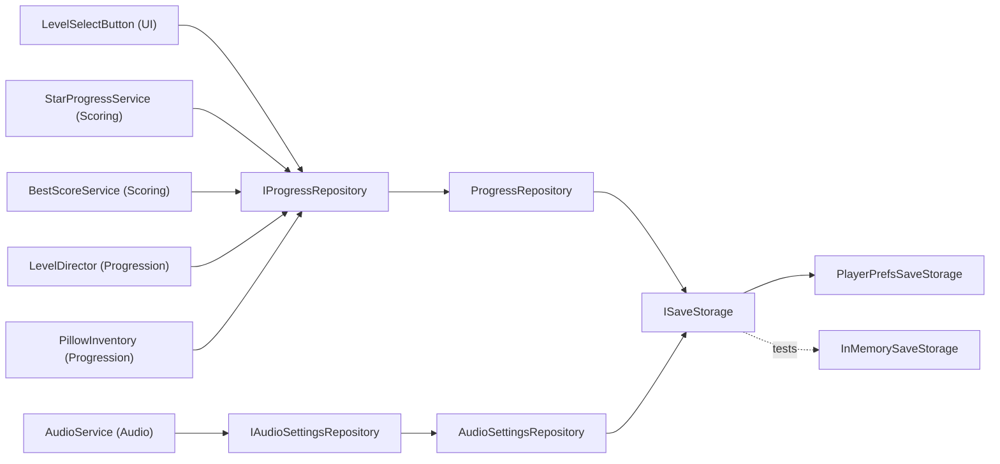

# 0003. Persistence abstraction

Status: Accepted
Date: 2026-09-12

## Context

Before this step, several classes wrote to `PlayerPrefs` directly, each spelling its own key format: the star-progress service wrote `{levelId}_Stars`, a level-unlock service wrote `{levelId}_Completed`, the best-score service wrote `BestScore_LVL_{buildIndex}` to a key nothing ever read back, and the audio manager wrote `MusicVolume`/`SFXVolume`. A level-select UI component read stars and completion straight out of `PlayerPrefs`, so the save format leaked into three assemblies and had no seam a test could stand in front of.

## Decision

Introduce `DreamVille.Persistence`, an assembly with an empty `references` array, and put the entire save surface behind three pieces:

- [`ISaveStorage`](../../Assets/_Project/Scripts/Persistence/ISaveStorage.cs) — the only interface allowed to touch a storage API (`HasKey`/`GetInt`/`SetInt`/`GetFloat`/`SetFloat`/`DeleteKey`/`Save`). Two implementations: [`PlayerPrefsSaveStorage`](../../Assets/_Project/Scripts/Persistence/PlayerPrefsSaveStorage.cs) in production, [`InMemorySaveStorage`](../../Assets/_Project/Scripts/Persistence/InMemorySaveStorage.cs) in tests — the latter also counts `Save()` calls so a test can assert flushing happened.
- [`SaveKeys`](../../Assets/_Project/Scripts/Persistence/SaveKeys.cs) — a static class that freezes the legacy key formats verbatim: `Stars(levelId) => levelId + "_Stars"`, `Completed(levelId) => levelId + "_Completed"`, `BestScore(levelId) => "BestScore_LVL_" + levelId`, plus the `MusicVolume`/`SFXVolume` constants (they double as `AudioMixer` parameter names — see [`MixerParams`](../../Assets/_Project/Scripts/Audio/MixerParams.cs)). One exception is deliberate and documented in the class itself: `BestScore` switched from a build-index key to a level-id key, because the old key had zero readers in the codebase — nobody could lose progress that was never loaded back.
- Two repositories built on `ISaveStorage`: [`IProgressRepository`](../../Assets/_Project/Scripts/Persistence/IProgressRepository.cs) (`GetStars`/`SetStarsIfHigher`/`IsCompleted`/`MarkCompleted`/`GetBestScore`/`TrySetBestScore`) and [`IAudioSettingsRepository`](../../Assets/_Project/Scripts/Persistence/IAudioSettingsRepository.cs) (`TryGetMusicVolume`/`TryGetSfxVolume`/`SetMusicVolume`/`SetSfxVolume`/`Flush`). Both refuse to write against an empty level id — [`ProgressRepository`](../../Assets/_Project/Scripts/Persistence/ProgressRepository.cs) logs an error and returns `false` instead of writing garbage — and `SetStarsIfHigher`/`TrySetBestScore` only persist when the new value beats the stored one.

All three project-scope bindings live in [`ProjectInstaller`](../../Assets/_Project/Scripts/Bootstrap/ProjectInstaller.cs) (`ISaveStorage → PlayerPrefsSaveStorage`, `IProgressRepository → ProgressRepository`, `IAudioSettingsRepository → AudioSettingsRepository`, all `BindInterfacesTo<>().AsSingle()`), so they are constructed once per application run and survive scene loads. Consumers — [`StarProgressService`](../../Assets/_Project/Scripts/Scoring/StarProgressService.cs), [`BestScoreService`](../../Assets/_Project/Scripts/Scoring/BestScoreService.cs), [`LevelDirector`](../../Assets/_Project/Scripts/Progression/LevelDirector.cs), [`AudioService`](../../Assets/_Project/Scripts/Audio/AudioService.cs), [`LevelSelectButton`](../../Assets/_Project/Scripts/UI/LevelSelectButton.cs) — take the repository interface through the constructor or `[Inject] Construct`; none of them sees `ISaveStorage` or a raw key string.

[`SaveKeysTests`](../../Assets/_Project/Tests/EditMode/Persistence/SaveKeysTests.cs) locks the key formats down — these assertions are never supposed to change, because changing one silently wipes real players' saves.

**Addendum (2026-09-25): pillow unlocks.** A fifth frozen key, `SaveKeys.UnlockedPillows = "UnlockedPillows"`, is global rather than per level: pillows unlocked in `Lobby_02` carry into every later level. It lives on `IProgressRepository` (`GetUnlockedPillows`/`SetUnlockedPillowsIfHigher`, write-only-when-higher like stars) instead of a new repository, keeping one progress seam. The domain model, [`PillowInventory`](../../Assets/_Project/Scripts/Progression/Pillows/PillowInventory.cs) in `Progression`, applies the per-level cap (`LevelDefinition.MaxPillows`) and seeds a save that predates the key once, from the highest cap among completed levels.

## Consequences

- `grep -rn PlayerPrefs Assets/_Project/Scripts` finds one implementation file, `PlayerPrefsSaveStorage.cs`, plus its binding line in `ProjectInstaller.cs` — the shortest possible proof that the save format is centralised.
- A JSON or cloud save backend is a second `ISaveStorage` implementation and one binding change; nothing above the interface needs to know.
- The `BestScore_LVL_{buildIndex}` records that already exist on a developer machine become unreachable once the key format switches to level id — accepted, because the key had no reader before this change, so no feature actually regresses.
- Repositories fail loudly (`Debug.LogError`) rather than silently on a missing level id; a caller that forgets to pass one sees it in the console immediately instead of losing a save quietly.

## Alternatives considered

- **JSON save file now**: versioned, human-readable, supports migrations. Deferred, not rejected — `ISaveStorage` is exactly the seam that makes it possible later without touching a single consumer; building it before the current save data needs it would be scope creep.
- **A static save-manager**: one global class with static methods, mirroring the pattern the old audio manager used. Rejected — untestable, and the project's conventions forbid static service access.
- **`PlayerPrefs` calls left in place, only deduplicated**: keep every service calling `PlayerPrefs` directly, share the key-format constants. Rejected — it does not remove the UI's direct read of the save file, and there is still no seam an EditMode test can substitute a fake into.
