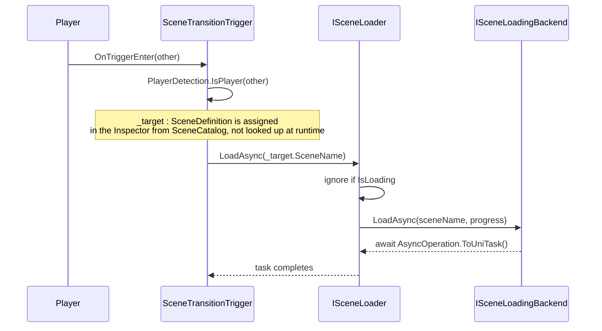

# 0004. Scene catalog and UniTask for gameplay async

Status: Accepted
Date: 2026-09-12

## Context

This record bundles two decisions that shipped in the same refactor phase because they solve the same underlying problem: a bare string or a coroutine standing in for something that should be a typed, cancellable operation.

**(a) Scene identity.** Before this step, scenes and levels were spelled out as string literals or raw build indices in several places: menu buttons loaded levels by build index, per-button components carried a level id used as a `PlayerPrefs` key, the best-score service derived its save key from the active scene's build index, and each portal component held a scene-name string. Several of those portal strings were already wrong — naming scenes that did not exist, or a scene that existed but was disabled in Build Settings — and nothing caught it until someone walked into the portal.

**(b) Async gameplay code.** Coroutines and string-based `Invoke` were used for bullet lifetime, pillow recall and NPC reactions. A coroutine cannot be awaited, composed, or cancelled from outside; a typo in an `Invoke` string fails silently at runtime. The project's conventions restrict coroutines to purely visual, non-cancellable, non-testable helpers and require `UniTask` with an explicit `CancellationToken` everywhere else.

## Decision

**(a) `SceneCatalog` is the only place a scene name or a level id is spelled out.** [`SceneDefinition`](../../Assets/_Project/Scripts/Configs/SceneDefinition.cs) is the identity of one scene (`SceneName`, `DisplayName`, `Music`); [`LevelDefinition`](../../Assets/_Project/Scripts/Configs/LevelDefinition.cs) extends it with `LevelId`, `StarRules` and `UnlockedByDefault` for scenes that are playable levels. [`SceneCatalog`](../../Assets/_Project/Scripts/Configs/SceneCatalog.cs) holds the bootstrap scene, the menu scene and the levels in play order, and exposes `FindBySceneName`/`FindLevelById`. `LevelDefinition` is a subclass of `SceneDefinition`, not a sibling type, specifically because one portal leads to the main menu rather than to another level — a uniform `SceneDefinition` reference on the portal component covers that case without a nullable "no level" special case.

Consumers resolve identity from the catalog instead of a literal:

- [`SceneTransitionTrigger`](../../Assets/_Project/Scripts/SceneManagement/SceneTransitionTrigger.cs) carries `[SerializeField] SceneDefinition _target` and calls `_sceneLoader.LoadAsync(_target.SceneName)`.
- [`ProgressionInstaller`](../../Assets/_Project/Scripts/Bootstrap/ProgressionInstaller.cs) resolves its `LevelDefinition` with `_catalog.FindBySceneName(gameObject.scene.name)` — one `GameplaySceneContext.prefab` instance, zero per-scene overrides for level identity (only the shared `ScoreRules` reference is still assigned on the prefab, not per scene).
- [`LevelSelectButton`](../../Assets/_Project/Scripts/UI/LevelSelectButton.cs) is a `[SerializeField] LevelDefinition` plus a `Button` and a star `Image[]`; it reads `IProgressRepository` for stars and unlock state and calls `ISceneLoader.LoadAsync(_level.SceneName)`.
- [`GameBootstrap`](../../Assets/_Project/Scripts/Bootstrap/GameBootstrap.cs) and [`GameFlowService`](../../Assets/_Project/Scripts/App/GameFlowService.cs) load `_catalog.MainMenuScene.SceneName`, not a serialized string.
- [`AudioService`](../../Assets/_Project/Scripts/Audio/AudioService.cs) looks up the music for a freshly loaded scene through `_catalog.FindBySceneName(scene.name)`.

**(b) UniTask with an explicit `CancellationToken` replaces coroutines and `Invoke` in gameplay-facing async code.** Every long-running operation gets its own lifetime, tied to the object that owns it:

- [`Bullet.ExpireAsync`](../../Assets/_Project/Scripts/Gameplay/Weapons/Bullets/Bullet.cs) arms a `CancellationTokenSource` linked to `GetCancellationTokenOnDestroy()` in `Launch`, and every early-return path (`ReturnToPool`, a relaunch, `OnDisable`) cancels it explicitly.
- [`PillowThrowHandler.RecallAsync`](../../Assets/_Project/Scripts/Gameplay/Weapons/Pillow/PillowThrowHandler.cs) moves a pillow toward the spawn point with `UniTask.Yield(PlayerLoopTiming.Update, token)` per frame instead of a coroutine, so the same token that stops the recall on destroy also lets the object be destroyed mid-flight without leaking a callback.
- [`NPCReactionController.ApplauseThenTalkAsync`](../../Assets/_Project/Scripts/Gameplay/NPC/NPCReactionController.cs) replaces a `WaitForSeconds` coroutine with `UniTask.Delay`, cancellable when a new reaction supersedes the current one.
- [`SceneLoader`](../../Assets/_Project/Scripts/SceneManagement/SceneLoader.cs) wraps Unity's `AsyncOperation` (via [`ISceneLoadingBackend`](../../Assets/_Project/Scripts/SceneManagement/ISceneLoadingBackend.cs)) with `.ToUniTask(progress: ...)`; the load itself is not cancellable mid-flight (Unity does not support cancelling a scene load once it starts), but the loader rejects an already-cancelled token before starting and ignores a concurrent request while one is in flight (`IsLoading` guard).

Every `Async` method takes a `CancellationToken`; every `Forget()` call site sits inside a `try`/`catch` that swallows `OperationCanceledException` and logs anything else.

## Consequences

- `grep`-ing the codebase for a hard-coded scene name or a `LoadLevel(int)` call returns nothing: renaming a scene, reordering levels, or changing which scene a portal leads to is a data change in the `SceneCatalog` asset, not a code change.
- EditMode tests build a `SceneCatalog` and `LevelDefinition`s in memory through `#if UNITY_INCLUDE_TESTS` `CreateForTests` factories (`InternalsVisibleTo("DreamVille.Tests.EditMode")` on `DreamVille.Configs`), without touching the real asset.
- The EditMode composition guard, [`SceneCompositionTests`](../../Assets/_Project/Tests/EditMode/Composition/SceneCompositionTests.cs), classifies a scene's role (bootstrap / menu / gameplay) through the real `SceneCatalog` asset rather than by file name, and checks that every enabled build scene has a catalog entry, that every `SceneTransitionTrigger` has a target and that every `ProgressionInstaller` can resolve its level. Renaming a scene therefore breaks a test, not a build.
- Every bullet, pillow and NPC reaction now owns a `CancellationTokenSource` scoped to its `GameObject`'s lifetime; a destroyed object cannot leave a dangling callback that fires against a missing component.

## Alternatives considered

- **Build indices for scene identity**: index-based level loading, as the project used before. Rejected — a build index shifts whenever a scene is added, removed or reordered in Build Settings, and does not survive a scene being renamed; a `LevelDefinition` asset is stable under both.
- **Addressables for scene loading**: would remove the Build Settings list entirely and support async content streaming. Deferred, not rejected — the current game has a fixed, small set of scenes shipped in the build, so the extra indirection buys nothing yet.
- **Coroutines, kept but tidied up**: keep `StartCoroutine` for bullet lifetime and pillow recall, just fix the bugs in place. Rejected — a coroutine cannot report failure to its caller, cannot be composed with other awaitables, and cannot be unit-tested without a running `MonoBehaviour`.
