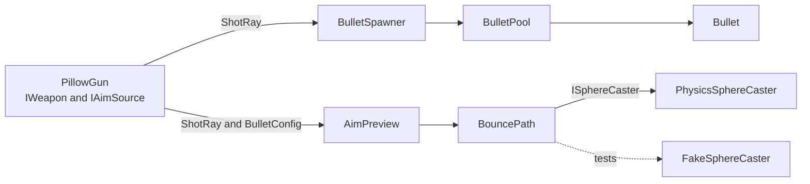
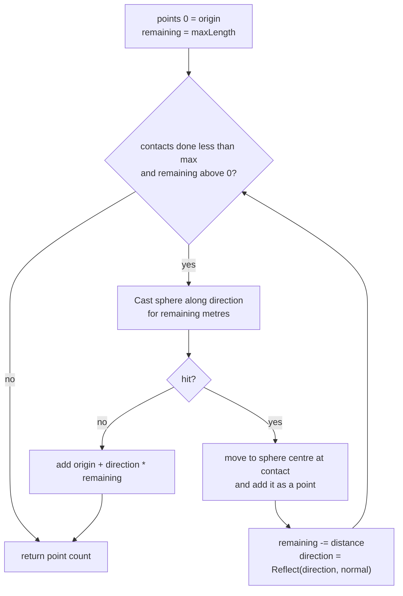
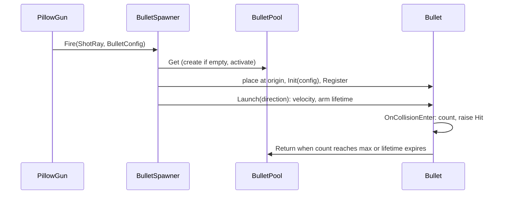

# Aim and ricochet

The player's gun fires pooled bullets that bounce off walls. While aim is held, a line shows the whole path.
Source: [`Gameplay/Weapons/`](../../Assets/_Project/Scripts/Gameplay/Weapons/).

Related: [ADR 0006](../adr/0006-unitask-lifetimes.md) (the bullet's lifetime timer),
[ADR 0005](../adr/0005-interaction-effects-as-components.md) (what a shot triggers on an interactable).
The pillow throw and recall (`PillowRack`, `PillowLauncher`) are a separate system, see
[`PillowRack.cs`](../../Assets/_Project/Scripts/Gameplay/Weapons/Pillows/PillowRack.cs).

## The problem

A preview that disagrees with the bullet is worse than none. The line must bounce where the bullet bounces and stop on the contact that ends it.
Three things keep the two in step:

1. **One shot description.** [`ShotRay`](../../Assets/_Project/Scripts/Gameplay/Weapons/ShotRay.cs) is a readonly struct with an origin
   and a normalized direction. It throws on a zero direction (`ShotRay.cs:13-14`).
   [`PillowGun`](../../Assets/_Project/Scripts/Gameplay/Weapons/PillowGun.cs) builds it from the muzzle
   (`PillowGun.cs:39`). `TryShoot` fires `Aim` (`:61`) and the preview reads the same `Aim`. The gun implements
   [`IAimSource`](../../Assets/_Project/Scripts/Gameplay/Weapons/IAimSource.cs) for the preview and `IWeapon` for the trigger.
2. **One config.** [`BulletConfig`](../../Assets/_Project/Scripts/Configs/BulletConfig.cs) holds radius, max collisions, speed and
   lifetime. The bullet uses it to fly. The preview uses it to trace. `Bullet.Init` copies the radius onto
   its collider (`Bullet.cs:64`), and a content test checks the prefab's radius equals the config's.
3. **One bounce budget.** The bullet dies on collision number `MaxCollisionCount` (`Bullet.cs:86`).
   `BouncePath` stops after the same number of contacts.

Values in [`BulletConfig.asset`](../../Assets/_Project/Settings/Bullet/BulletConfig.asset): damage 10, speed 15 m/s,
life time 8 s, max collision count 6, collision radius 0.25 m.

## BouncePath: pure math behind a seam

[`BouncePath.Compute`](../../Assets/_Project/Scripts/Gameplay/Weapons/Aiming/BouncePath.cs) is a static function.
It takes the ray, the radius, the contact budget, the length budget, an
[`ISphereCaster`](../../Assets/_Project/Scripts/Gameplay/Weapons/Aiming/ISphereCaster.cs) and a caller-owned buffer.
It does not touch `Physics` and allocates nothing.

**Why the seam.** `ISphereCaster.Cast` answers one question: sweep a sphere, how far did its centre travel and what
is the surface normal? Production code uses
[`PhysicsSphereCaster`](../../Assets/_Project/Scripts/Gameplay/Weapons/Aiming/PhysicsSphereCaster.cs), which wraps
`Physics.SphereCast`. It skips the player and player-bullet layers and ignores triggers (`PhysicsSphereCaster.cs:13,18`),
so the line never stops at the shooter. It is bound in
[`PlayerInstaller`](../../Assets/_Project/Scripts/Gameplay/Player/PlayerInstaller.cs) (`:78`). EditMode tests pass
[`FakeSphereCaster`](../../Assets/_Project/Tests/EditMode/Fakes/FakeSphereCaster.cs), a world of analytic planes. The
algorithm is tested to the millimetre with no scene and no physics step.

**The algorithm** (`BouncePath.cs:36-59`):

1. Validate: a null caster or buffer throws, a negative contact count throws, a buffer shorter than
   `RequiredCapacity(maxContacts)` (`maxContacts + 1`) throws (`:24-34`).
2. Write the origin as point 0. Set `remaining = maxLength`.
3. Repeat while fewer than `maxContacts` contacts are done and `remaining > 0`:
   1. Sweep the sphere from the current position along the current direction for `remaining` metres.
   2. No hit: write `position + direction * remaining` and stop. The bullet would run out of range in the open.
   3. Hit: move the position along the ray by the cast distance and write it. This is the sphere centre at contact.
      It is not `hit.point`, which lies on the surface and, for an oblique hit, off the ray (`:51-53`).
   4. Subtract the distance from `remaining`, then reflect the direction with `Vector3.Reflect(direction, normal)`.
4. After the last allowed contact, return. The bullet dies on that contact, so the path ends there.

What stops the path, in the order the loop checks them: the contact budget (`maxContacts`, from
`BulletConfig.MaxCollisionCount`), the length budget (`maxLength`, from `BulletConfig.MaxTravelDistance`), and a cast
that finds nothing. The result has at most `maxContacts + 1` points, which is why
[`AimPreview`](../../Assets/_Project/Scripts/Gameplay/Weapons/Aiming/AimPreview.cs) allocates `RequiredCapacity(...)` points once in
`Awake` (`AimPreview.cs:39`).

`AimPreview` itself is thin. In `LateUpdate`, so it draws after the player has turned towards the aim, it hides the
line unless aim is held and `CanAim` is true (`:49-55`). Otherwise it calls `Compute` and hands the buffer to the
`LineRenderer`; Unity copies only `positionCount` entries (`:58-67`). It lives on the gun's object, so an unequipped gun
draws nothing.

**Known limit.** `MaxTravelDistance` is `Speed x LifeTime`, an upper bound. The bullet prefab's rigidbody damping makes
the real range shorter, so the line can run past the point where a bullet would die of old age (comment at
`BulletConfig.cs:33-37`). The contact count is exact. The range is not.

## The runtime bullet

- **Pooling.** [`BulletPool`](../../Assets/_Project/Scripts/Gameplay/Weapons/Bullets/BulletPool.cs) is a queue of inactive bullets.
  `Get` creates one when the queue is empty, so the pool grows on demand (`:20-21`). `Return` is idempotent: a `HashSet`
  stops a double return from queueing a bullet twice (`:35`).
- **Spawning.** [`BulletSpawner`](../../Assets/_Project/Scripts/Gameplay/Weapons/Bullets/BulletSpawner.cs) is the facade:
  get, place with `shot.Origin` and `shot.Rotation`, `Init`, register with the event relay, `Launch(shot.Direction)`
  (`BulletSpawner.cs:22-27`). [`CombatInstaller`](../../Assets/_Project/Scripts/Bootstrap/CombatInstaller.cs) creates the
  pool, spawner and relay once per scene from a prefab. `PillowGun` sees only `IBulletSpawner`.
- **Lifetime.** [`Bullet`](../../Assets/_Project/Scripts/Gameplay/Weapons/Bullets/Bullet.cs) arms a UniTask delay in `Launch`
  (`Bullet.cs:74,101-106`). `ExpireAsync` waits `LifeTime` seconds of scaled game time and returns the bullet to the pool
  (`:118-124`). The token is linked to the destroy token. It is cancelled when the bullet returns, is disabled
  or relaunches (`:39-44,108-116`). Pause freezes the wait. This is the one-shot, object-bound pattern from
  [ADR 0006](../adr/0006-unitask-lifetimes.md). `ReturnToPool` checks `_isInFlight` first, so expiry and the last
  collision cannot both return the same bullet (`:90-93`).
- **Ricochet budget.** Each collision while in flight increments `_hitCount` and raises `Hit` (`:82-84`). At
  `_hitCount >= MaxCollisionCount` the bullet returns to the pool (`:86-87`). The hit count travels in
  [`BulletHitInfo`](../../Assets/_Project/Scripts/Gameplay/Weapons/Bullets/BulletHitInfo.cs): 1 for the first contact,
  2 after one ricochet. `Hit` is raised through `IsolatedEvent`, so one throwing handler cannot skip the return to the pool.
- **Hit handlers** are separate components that subscribe to `Bullet.Hit`:
  - [`BulletDamageHandler`](../../Assets/_Project/Scripts/Gameplay/Weapons/Bullets/BulletDamageHandler.cs): if the target has an
    `IDamageable`, calls `TakeDamage(damage, hitCount)`. The enemy page shows where the hit count goes
    ([enemy state machine](enemy-state-machine.md)).
  - [`BulletInteractionHandler`](../../Assets/_Project/Scripts/Gameplay/Weapons/Bullets/BulletInteractionHandler.cs): if the target
    has an `IInteractable`, calls `OnInteract(InteractionContext.Shot(transform))`. The context carries the source
    `Shot` and the bullet's transform as instigator
    ([`InteractionContext`](../../Assets/_Project/Scripts/Gameplay/Interactables/InteractionContext.cs)).
  - [`BulletEventRelay`](../../Assets/_Project/Scripts/Gameplay/Weapons/Bullets/BulletEventRelay.cs): folds every bullet's `Hit`
    into one `BulletHit` event, exposed as `IBulletHitSource`. The HUD presenter uses it for ricochet badges.
- **Impact effect.** [`BulletVfxHandler`](../../Assets/_Project/Scripts/Gameplay/Weapons/Bullets/BulletVfxHandler.cs) detaches the
  hit particle system from the bullet in `Awake` (`:28`). On each hit it moves the effect to `HitPoint` and plays it
  (`:58-59`). Because the effect no longer hangs under the bullet, deactivating the pooled bullet on its last
  contact does not cut the final burst short. The effect simulates in world space, so earlier bursts stay where they hit. The effect
  is destroyed with the bullet (`:46-50`). The handler also clears the trails when the bullet is disabled (`:38-41`).

## Tests

Under [`Tests/EditMode/Weapons/`](../../Assets/_Project/Tests/EditMode/Weapons/), plus
[`FakeSphereCaster`](../../Assets/_Project/Tests/EditMode/Fakes/FakeSphereCaster.cs).

| Test class | What it pins |
|---|---|
| `BouncePathTests` | no hit ends at `maxLength` along the ray. An angled wall gives the sphere centre at `10 - r * sqrt(2)`, not the surface point. A corridor stops after exactly `maxContacts` contacts (3 casts, 4 points). An exhausted length budget truncates the last segment. The radius reaches the caster. A short buffer throws. |
| `ShotRayTests` | the direction is normalized and a zero direction throws |
| `ShotCooldownTests` | the first shot is ready, not ready before the interval, ready at exactly the interval, a negative or NaN interval throws |
| `WeaponControllerTests` | fire input calls `TryShoot` after `Initialize` and is ignored after `Dispose` |
| `BulletPoolTests` | a double return keeps one queue entry and two `Get` calls give two instances |
| `WeaponConfigContentTests` | `BulletConfig.CollisionRadius` equals the bullet prefab's `SphereCollider` radius |
| `WeaponPrefabTests` | the gun has a muzzle (`WeaponPivot`, identity rotation) and a config. The character prefab has exactly one `AimPreview` with a line and no `WeaponController` component. The bullet's hit effect simulates in world space. |

Not covered by an EditMode test: `Bullet` itself (collision counting, expiry), `BulletSpawner`, `AimPreview`
and `PhysicsSphereCaster`. They need physics or Play Mode.
