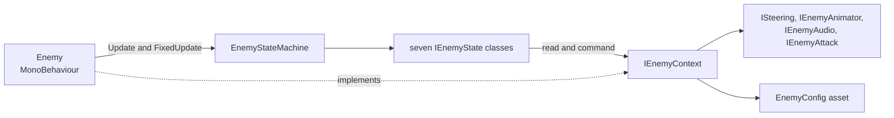
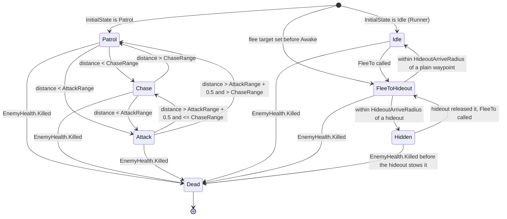
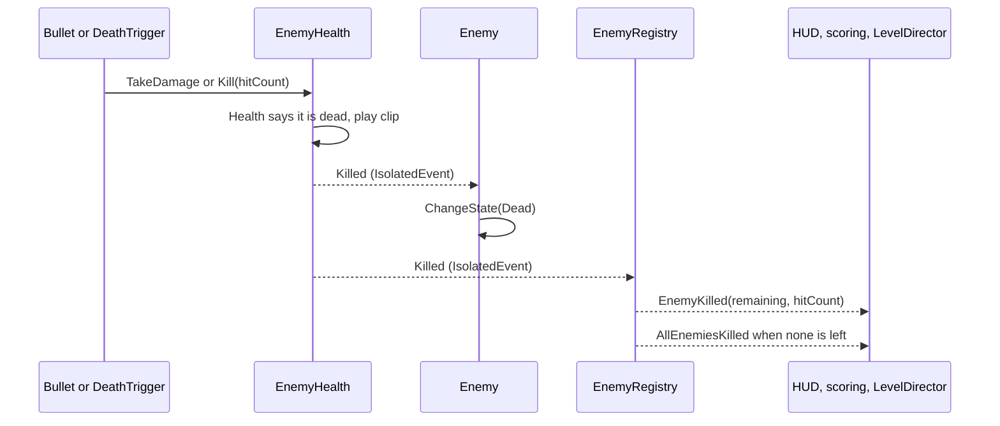

# Enemy state machine

How a placed enemy decides what to do, and how its death reaches the level.
Source: [`Gameplay/Enemies/`](../../Assets/_Project/Scripts/Gameplay/Enemies/).

Why it looks like this: [ADR 0011](../adr/0011-enemy-archetypes.md) (tuning lives in config assets),
[ADR 0006](../adr/0006-unitask-lifetimes.md) (timers and their lifetimes),
[ADR 0010](../adr/0010-renaming-serialized-fields.md) (serialized names stay safe).

## Shape

One enemy is one `MonoBehaviour`, a plain state machine and seven small state classes.

- [`Enemy`](../../Assets/_Project/Scripts/Gameplay/Enemies/Enemy.cs) is thin. It builds the machine and the seams in `Awake`,
  and forwards `Update` to `Tick` and `FixedUpdate` to `FixedTick` (`Enemy.cs:161-163`). Nothing else drives the machine.
- [`IEnemyContext`](../../Assets/_Project/Scripts/Gameplay/Enemies/IEnemyContext.cs) is everything a state may see:
  the config, positions, steering, animator, audio, attack, the patrol route and the flee target.
  `Enemy` implements it with explicit interface members, so none of it is public API of the component (`Enemy.cs:216-266`).
  EditMode tests use [`FakeEnemyContext`](../../Assets/_Project/Tests/EditMode/Fakes/FakeEnemyContext.cs) instead.
- [`EnemyStateMachine`](../../Assets/_Project/Scripts/Gameplay/Enemies/States/EnemyStateMachine.cs) holds one state per
  [`EnemyStateId`](../../Assets/_Project/Scripts/Configs/Enemies/EnemyStateId.cs) in an array, so a transition does not allocate.
  It is guarded:
  - `ChangeState` to the current state returns `false` and does not re-enter it (`EnemyStateMachine.cs:69`).
  - Once the machine is in `Dead`, every `ChangeState` returns `false` (`EnemyStateMachine.cs:72`).
  - An unregistered id throws, and so does a duplicate id in the constructor.
  - `StateChanged` fires after `Exit` and before `Enter`.
- States and machine reference each other, so the constructor takes a factory that receives the machine under
  construction (`Enemy.cs:112-121`). Both sides keep `readonly` fields.
- Movement and turning are separate seams. [`RigidbodySteering`](../../Assets/_Project/Scripts/Gameplay/Enemies/Steering/RigidbodySteering.cs)
  adds an acceleration force. [`SteeringMath`](../../Assets/_Project/Scripts/Gameplay/Enemies/Steering/SteeringMath.cs) is the
  pure part: `(flatten(direction).normalized * targetSpeed - flatten(velocity)) * acceleration`.
  Steering is horizontal only. Gravity owns the vertical axis (`SteeringMath.cs:13-14`).
- [`EnemyRotationHandler`](../../Assets/_Project/Scripts/Gameplay/Enemies/EnemyRotationHandler.cs) turns the body towards
  its horizontal velocity while enabled (`EnemyRotationHandler.cs:25-33`). `FaceTowards` slerps at the config's
  rotation speed. `SnapTo` turns at once. Disabling the component stops only the automatic facing.

## States and transitions

Chase and Attack check the player each frame in `Tick`. Patrol checks chase first, then attack.
Any state can go to `Dead` and `Dead` is terminal. `FleeTo` works from any state of a running machine (`Enemy.cs:70-83`);
the diagram lists the cases in the scenes. `FleeToHideout`, `Hidden` and `Idle` are never left by a range check.

| State | Enter / Exit | While it runs | Leaves when |
|---|---|---|---|
| [`Idle`](../../Assets/_Project/Scripts/Gameplay/Enemies/States/EnemyIdleState.cs) | stops, snaps facing to the player, turns auto-facing off (`:14-21`). Exit turns it back on (`:26`). | nothing | `FleeTo` or death |
| [`Patrol`](../../Assets/_Project/Scripts/Gameplay/Enemies/States/EnemyPatrolState.cs) | none | walks the route. With no route it faces the player (`:40-44`). | chase range (`:28`), attack range (`:34`) |
| [`Chase`](../../Assets/_Project/Scripts/Gameplay/Enemies/States/EnemyChaseState.cs) | none | accelerates at the player | `< AttackRange` to Attack (`:21`), `> ChaseRange` to Patrol (`:27`) |
| [`Attack`](../../Assets/_Project/Scripts/Gameplay/Enemies/States/EnemyAttackState.cs) | stops, snaps facing, auto-facing off (`:25-29`). Exit turns it on (`:57`). | slerps to the player, throws on a cooldown | `> AttackRange + AttackExitMargin` (`:40-42`) |
| [`FleeToHideout`](../../Assets/_Project/Scripts/Gameplay/Enemies/States/EnemyFleeToHideoutState.cs) | starts the move animation | steers to the flee target | `distance < HideoutArriveRadius`: becomes vulnerable, then Hidden or Idle (`:27-32`) |
| [`Hidden`](../../Assets/_Project/Scripts/Gameplay/Enemies/States/EnemyHiddenState.cs) | stops, hands the enemy to the hideout (`:15-16`) | the hideout opens its door, shrinks the body in, then deactivates it ([`EnemyHideout`](../../Assets/_Project/Scripts/Gameplay/Enemies/EnemyHideout.cs)) | `FleeTo` again, or death while it is still active |
| [`Dead`](../../Assets/_Project/Scripts/Gameplay/Enemies/States/EnemyDeadState.cs) | releases the body to physics, plays death, schedules despawn (`:14-17`) | nothing | never |

Details the code pins:

- **Attack has hysteresis.** It enters inside `AttackRange` and holds until `AttackRange + AttackExitMargin`.
  `AttackExitMargin` is the constant `0.5` metres (`EnemyAttackState.cs:15`). A player backing off at the range edge
  does not flip the enemy between Attack and Chase each frame.
- **Leaving Attack is explicit.** It goes to Chase only if the player is within `ChaseRange`, otherwise to Patrol (`:42`).
  A chase range of 0 therefore always means Patrol.
- **The cooldown survives re-entry.** `_cooldown` is a field that `Enter` does not reset (`:17`). The first throw of a
  fresh enemy is immediate, because the field starts at 0 (`:46-47`). The throw direction is from the projectile
  origin to the player (`:49`).
- **Patrol keeps its route index** when it is entered again (`EnemyPatrolState.cs:14`). After a chase the enemy
  heads for the point it was walking to.
- **A one-point `Loop` route is a post.** `AdvancePoint` loops only when the route has more than one point (`:64`).
  With one point the enemy falls through to the stop branch, sets `_hasStoppedAtEnd` and holds still (`:76-77`), instead of
  re-targeting the point it stands on.
- **`Once` stops at the last point** by the same branch (`:70-77`). Empty slots in the designer's array are dropped
  first by [`PatrolRoute.WithoutEmptySlots`](../../Assets/_Project/Scripts/Gameplay/Enemies/PatrolRoute.cs), called from `Enemy.Awake` (`Enemy.cs:106`).
- **Idle owns its facing.** It has no tick to finish a gradual turn, so it snaps and disables auto-facing until it exits.
  Otherwise the body would turn after its own drift.
- **Chase has no hysteresis.** Its two guards are strict (`<` and `>`) and sit on different ranges.
- **A missing config disables the enemy.** `Awake` logs an error and sets `enabled = false` (`Enemy.cs:98-103`).

## Tuning: seven archetypes

Every number comes from an [`EnemyConfig`](../../Assets/_Project/Scripts/Configs/Enemies/EnemyConfig.cs) asset in
[`Settings/Enemies/`](../../Assets/_Project/Settings/Enemies/). A placed enemy serializes three fields only:
`_config`, `_patrolPoints` and `_attackSpawn` (`Enemy.cs:32-37`). Instances never override the numbers ([ADR 0011](../adr/0011-enemy-archetypes.md)).
A chase range of 0 means "never chases".

| Asset | Move | Chase | Attack | Cooldown | Turn | Role | Enemies |
|---|---|---|---|---|---|---|---|
| `EnemyConfig_Hunter` | 5 | 7 | 5 | 4 | 8 | walks its route, chases, throws. Base-prefab default. | 43 |
| `EnemyConfig_Stalker` | 1 | 10 | 5 | 2 | 1 | creeps after the player from far | 20 |
| `EnemyConfig_RapidSentry` | 4 | 0 | 5 | 1 | 1 | never chases, fast thrower, walks to a post | 20 |
| `EnemyConfig_Sentry` | 0 | 0 | 5 | 2 | 1 | stands where placed, throws | 13 |
| `EnemyConfig_Lookout` | 3 | 0 | 10 | 2 | 8 | never chases, throws from long range | 14 |
| `EnemyConfig_Runner` | 5 | 0 | 0 | 0 | 8 | no attack, flees into hideouts | 25 |
| `EnemyConfig_Walker` | 4 | 7 | 5 | 2 | 10 | the fridge walkers, patrol mode `Once` | 2 |

Units: speed in m/s, ranges in metres, cooldown in seconds, turn is the slerp rate per second.
Enemy counts are the rows per `config` in
[`EnemyTuningSnapshot.tsv`](../../Assets/_Project/Tests/EditMode/Enemies/EnemyTuningSnapshot.tsv), 137 enemies in all.

Shared by all seven assets: acceleration 6 (Runner: 10), patrol arrive radius 0.5, hideout arrive radius 2,
throw impulse 5, projectile lifetime 5 s, despawn delay 7 s. `Runner` also spawns invulnerable for 1 s, has no
attack (`EnemyAttackKind.None`) and starts in `Idle`. Every other archetype starts in `Patrol`.
`Walker` is the only asset with `PatrolMode.Once`.

## Death feeds the level

- [`EnemyHealth`](../../Assets/_Project/Scripts/Gameplay/Enemies/EnemyHealth.cs) wraps the plain `Health` class.
  `TakeDamage` ignores damage while the enemy is dead or in an immunity window (`:52-53`).
  `Kill(hitCount)` is the death API: it ignores immunity and does nothing once dead (`:61-69`).
  [`DeathTrigger`](../../Assets/_Project/Scripts/Gameplay/Environment/DeathTrigger.cs) uses it for fall volumes, so an
  enemy inside its spawn immunity does not fall forever (`DeathTrigger.cs:21-25`).
- `Killed` is raised once, before `Died`, through [`IsolatedEvent`](../../Assets/_Project/Scripts/Core/Events/IsolatedEvent.cs)
  (`EnemyHealth.cs:81-82`). One throwing listener is logged and the others still run, so the state machine, the registry
  and the objectives each hear about the death.
- [`EnemyRegistry`](../../Assets/_Project/Scripts/Gameplay/Enemies/EnemyRegistry.cs) is a plain class, not a component.
  The container builds its roster in [`CombatInstaller`](../../Assets/_Project/Scripts/Bootstrap/CombatInstaller.cs) with
  `FromComponentsInHierarchy(includeInactive: true)` (`:45`), so enemies that wait for a wave are counted.
  The roster arrives through the constructor, before any `Initialize` runs.
- On each death the registry unsubscribes from that enemy, removes it (a second kill counts once) and raises
  `EnemyKilled(remaining, hitCount)`. When the list is empty it raises `AllEnemiesKilled` (`EnemyRegistry.cs:50-62`).
  `ScoringCoordinator` listens to both and `LevelDirector` to the second, which completes the level.
- `Enemy` also raises a `Destroyed` event from `OnDestroy`. `EnemyHideout` uses it to forget an enemy (`Enemy.cs:170`).

Timers use `GameTime` and `UniTask`, as [ADR 0006](../adr/0006-unitask-lifetimes.md) describes: the spawn immunity window
(`Enemy.cs:142-143`) and the hideout shrink-in. Neither is a coroutine.

## Tests

All under [`Tests/EditMode/Enemies/`](../../Assets/_Project/Tests/EditMode/Enemies/). The state tests run against the
fake context. No test needs a scene or physics, except the content and snapshot tests, which read assets.

| Test class | What it pins |
|---|---|
| `States/EnemyStateMachineTests` | initial state and `StateChanged`, Exit before Enter, same-state refusal, `Dead` refuses changes, unregistered id and duplicate id throw, no tick before start |
| `EnemyIdleStateTests` | snaps facing on enter, restores auto-facing on exit |
| `EnemyPatrolStateTests` | chase and attack transitions, chase range 0 attacks at point-blank range, no player means no transition, empty route faces the player, `Loop` wraps, `Once` stops, route resumes after a chase, a one-point route stops |
| `EnemyChaseStateTests` | back to Patrol outside chase range, Attack inside attack range, steering uses the config's speed and acceleration |
| `EnemyAttackStateTests` | enter stops and snaps, one throw per cooldown, leaving without chase range patrols and restores auto-facing, leaving within chase range chases, just past the attack range keeps attacking |
| `EnemyFleeToHideoutStateTests` | steering before arrival, arrival at a hideout becomes vulnerable and goes Hidden, arrival at a waypoint goes Idle |
| `EnemyHiddenStateTests` | enter stops the body |
| `EnemyDeadStateTests` | releases the body, triggers death, schedules the despawn |
| `EnemyHealthTests` | `Killed` before `Died`, hit count passed on, immunity blocks damage, `Kill` ignores immunity, nothing re-fires after death, a throwing `Killed` listener still lets `Died` run |
| `EnemyRegistryTests` | remaining count and hit count, `AllEnemiesKilled` once, the same enemy counts once, no events after `Dispose` |
| `SteeringMathTests`, `PatrolRouteTests` | the pure math: no vertical component, empty slots dropped |
| `EnemyContentTests` | every config has valid timings, chase range is 0 or beyond attack range, no attack means attack range 0, throwers have positive range, cooldown and turn rate, prefabs have a config and an attack spawn |
| `EnemyTuningSnapshotTests` | see below |

**The tuning snapshot.** [`EnemyTuningSnapshot.tsv`](../../Assets/_Project/Tests/EditMode/Enemies/EnemyTuningSnapshot.tsv)
has one row per enemy in every prefab and scene: the five numbers as the asset resolves them, the attack spawn,
the patrol route and the config name. `EnemyTuningSnapshotTests` scans all assets once and checks that
each row matches, that no asset with enemies is missing from the file, that keys are unique and that an enemy with
move speed 0 has no patrol route. Retuning an archetype fails the test until the TSV lists every enemy it reaches,
so a balance change shows up as a reviewable diff. A serialized rename that loses designer data fails it too.

## Not covered

`Enemy` itself and `EnemyHideout` have no EditMode test of their own. `Enemy` is covered through its seams and the
content tests. The projectile (`Combat/EnemyProjectile`) is only checked as a prefab by `EnemyContentTests`.
