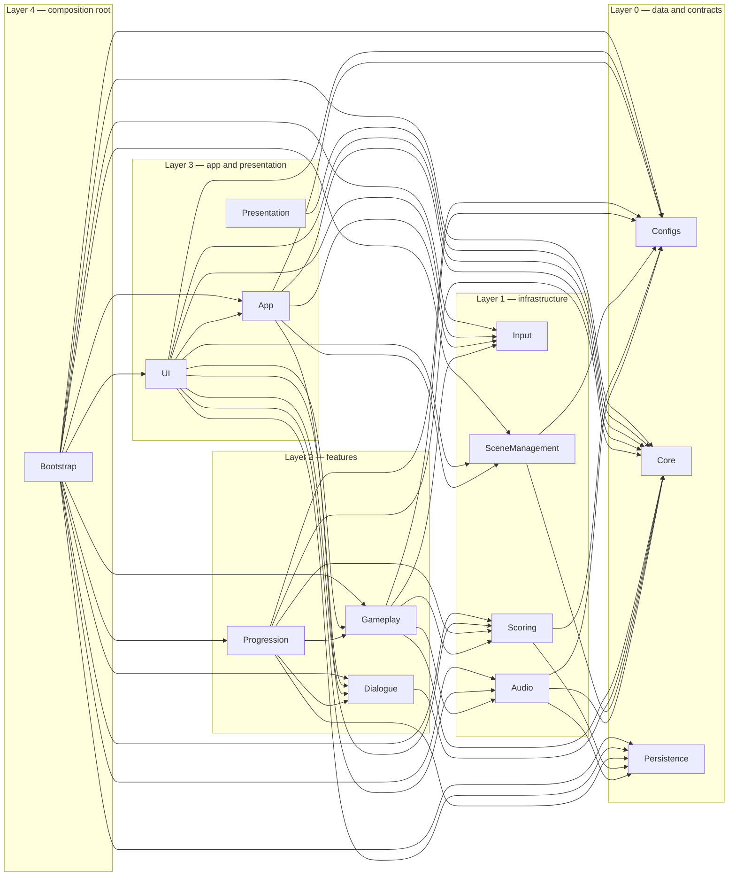

# DreamVille

A cozy third-person shooter built with Unity 6 (URP): pillows ricochet off walls into
runaway "nightmare" enemies, townsfolk NPCs react and talk back, and lobbies open the
way into the next level.

DreamVille started as a small team project: gameplay, art and level content are the
team's, and folder names such as `Scenes/Max` still carry that history. It is now being
reworked, solo, into a portfolio piece: layered assemblies, a Zenject composition root,
centralised persistence, data-driven scene identity and an EditMode test suite. The
architecture refactor documented below is the author's.

## Screenshots

_A gameplay GIF and screenshots are coming with the playable build._

## Highlights

- **Composition root with fixed entry points.** `ProjectContext` holds app-lifetime
  services; one shared
  [`GameplaySceneContext.prefab`](Assets/_Project/Prefabs/Bootstrap/GameplaySceneContext.prefab)
  wires all six gameplay scenes, `MainMenuContext.prefab` wires the menu. Services are
  bound by interface, so consumers depend on `IScoreService` or `IEnemyRegistry`, never
  a concrete type. [ADR 0001](Docs/adr/0001-zenject-composition-root.md).
- **Layered, acyclic assembly graph.** 14 runtime `.asmdef`s; every reference points from
  a feature toward the infrastructure it needs. 13 of 14 set `"autoReferenced": false`
  (`Bootstrap`, the composition root, is the exception) and only `Presentation` links the
  render pipeline. [ADR 0002](Docs/adr/0002-assembly-layering.md).
- **A composed player.** `Character.prefab` carries a Zenject `GameObjectContext`;
  [`PlayerInstaller`](Assets/_Project/Scripts/Gameplay/Player/PlayerInstaller.cs) builds
  movement, gravity, jump, look, knockback and hit recovery as plain, unit-tested
  classes, and [`PlayerMotor`](Assets/_Project/Scripts/Gameplay/Player/PlayerMotor.cs)
  moves the body once per frame.
- **One persistence seam, data-driven scene identity.** Every save goes through
  [`ISaveStorage`](Assets/_Project/Scripts/Persistence/ISaveStorage.cs) and two
  repositories, with key formats frozen in
  [`SaveKeys`](Assets/_Project/Scripts/Persistence/SaveKeys.cs).
  `SceneCatalog` and `LevelDefinition` assets are the only place a scene name or level
  id is spelled out. [ADR 0003](Docs/adr/0003-persistence-abstraction.md),
  [ADR 0004](Docs/adr/0004-scene-catalog-and-async.md).
- **One interaction channel, composable effects.** A bullet hit and a player touch both
  become an `InteractionContext` for `IInteractable.OnInteract`. Two thin hosts
  (`Interactable`, `Pickup`) run the `IInteractionEffect` components beside them: a lamp
  is `Interactable` + `ToggleLightEffect` + `PlayAudioSourceEffect`, see
  [`InteractableLamp.prefab`](Assets/_Project/Prefabs/InteractableLamp.prefab).
  [ADR 0005](Docs/adr/0005-interaction-effects-as-components.md).
- **UniTask with cancellation instead of coroutines.** Gameplay waits through
  [`GameTime`](Assets/_Project/Scripts/Core/Async/GameTime.cs) on scaled time, with two
  lifetime models: one-shot sequences die with their object, endless loops follow
  `OnEnable`/`OnDisable`. No coroutine remains:
  [`CoroutineGuardTests`](Assets/_Project/Tests/EditMode/Architecture/CoroutineGuardTests.cs)
  fails on any coroutine API, and its allow-list for deliberate exceptions is empty.
  [ADR 0006](Docs/adr/0006-unitask-lifetimes.md).
- **UI as MVP, dialogues as data.** The HUD, menus and dialogues are plain presenters
  over passive views, tested with fakes and no scene
  ([ADR 0007](Docs/adr/0007-hud-mvp.md), [ADR 0008](Docs/adr/0008-menus-mvp.md)). The 15
  conversations are `DialogueDefinition` assets on one `Dialogues` string table (ru, en);
  a checked-in snapshot of all 53 lines proves the move out of the scenes lost no text,
  and the move fixed a shipped bug where English dialogues never started. Screen hints
  use a `Hints` table the same way, so the English game is English from the first lobby.
  [ADR 0009](Docs/adr/0009-data-driven-dialogues.md).
- **679 EditMode tests that guard the wiring and the data.**
  [`SceneCompositionTests`](Assets/_Project/Tests/EditMode/Composition/SceneCompositionTests.cs)
  opens every build scene and checks its installers, catalog references and missing
  scripts, and prefab tests pin the player's composition, so a mis-wired scene fails a
  test run instead of a play session. Naming and serialized-data hygiene are tests, not
  reviews: no asset keeps data under a renamed field's old name, and every enemy's
  per-instance tuning is pinned in a snapshot ([ADR 0010](Docs/adr/0010-renaming-serialized-fields.md)).

## Architecture

The graph is read off the `.asmdef` files under
[`Assets/_Project/Scripts`](Assets/_Project/Scripts) (project-to-project edges only).



`ProjectContext` (`ProjectInstaller`) holds services that outlive a scene. Each gameplay
scene carries the same `GameplaySceneContext.prefab` (`SceneServicesInstaller`,
`CombatInstaller`, `ProgressionInstaller`, `UiInstaller`); the menu scene carries
`MainMenuContext.prefab`. Runtime flow: the `GameStart` scene plays the intro, then
`GameBootstrap` loads the scene `SceneCatalog` names as the main menu; a level button
makes `LevelSelectPresenter` ask `ISceneLoader` to load its `LevelDefinition`'s scene.

## Where to look first

- [`Bootstrap/ProjectInstaller.cs`](Assets/_Project/Scripts/Bootstrap/ProjectInstaller.cs) — the app-lifetime composition root: every project-scope binding in one file. [`GameplaySceneContext.prefab`](Assets/_Project/Prefabs/Bootstrap/GameplaySceneContext.prefab) is the installer set shared by the six gameplay scenes.
- [`Gameplay/Enemies/States/EnemyStateMachine.cs`](Assets/_Project/Scripts/Gameplay/Enemies/States/EnemyStateMachine.cs) — guarded enemy state machine; [`Enemy.cs`](Assets/_Project/Scripts/Gameplay/Enemies/Enemy.cs) is the thin MonoBehaviour its seven states see through `IEnemyContext`, and `EnemyConfig` assets hold the archetype tuning.
- [`Gameplay/Player/PlayerInstaller.cs`](Assets/_Project/Scripts/Gameplay/Player/PlayerInstaller.cs) — the player prefab's own composition root; [`PlayerMotor.cs`](Assets/_Project/Scripts/Gameplay/Player/PlayerMotor.cs) shows the fixed per-frame order.
- [`Gameplay/Weapons/Pillow/PillowRack.cs`](Assets/_Project/Scripts/Gameplay/Weapons/Pillow/PillowRack.cs) — the throw / recall / freeze rules of the core mechanic as a plain, unit-tested class; [`PillowLauncher.cs`](Assets/_Project/Scripts/Gameplay/Weapons/Pillow/PillowLauncher.cs) is the thin shell with a cancellable UniTask recall loop.
- [`Gameplay/Weapons/Aiming/BouncePath.cs`](Assets/_Project/Scripts/Gameplay/Weapons/Aiming/BouncePath.cs) — the ricochet preview as pure math behind an `ISphereCaster` seam; the gun and the preview read one `ShotRay`, so the line ends where the bullet dies.
- [`Gameplay/Interactables/EffectChain.cs`](Assets/_Project/Scripts/Gameplay/Interactables/EffectChain.cs) — turns sibling `IInteractionEffect` components into one ordered, fault-isolated call; [`Interactable.cs`](Assets/_Project/Scripts/Gameplay/Interactables/Interactable.cs) is its host.
- [`Progression/LevelDirector.cs`](Assets/_Project/Scripts/Progression/LevelDirector.cs) — level completion as a plain class: no MonoBehaviour, no `Update` polling.
- [`UI/Hud/HudPresenter.cs`](Assets/_Project/Scripts/UI/Hud/HudPresenter.cs) — the HUD as MVP: a plain presenter over small view interfaces, tested with fakes. [`DialoguePresenter.cs`](Assets/_Project/Scripts/UI/Dialogues/DialoguePresenter.cs) and [`LevelSelectPresenter.cs`](Assets/_Project/Scripts/UI/Menus/LevelSelectPresenter.cs) follow the same pattern.
- [`Tests/EditMode/Dialogue/DialogueContentTests.cs`](Assets/_Project/Tests/EditMode/Dialogue/DialogueContentTests.cs) — compares every dialogue definition with the checked-in [`DialogueSnapshot.tsv`](Assets/_Project/Tests/EditMode/Dialogue/DialogueSnapshot.tsv), so a lost or changed line fails a test. [`ProximityHintContentTests`](Assets/_Project/Tests/EditMode/UI/ProximityHintContentTests.cs) does the same for the 14 screen hints.
- [`Tests/EditMode/Composition/SceneCompositionTests.cs`](Assets/_Project/Tests/EditMode/Composition/SceneCompositionTests.cs) — opens every build scene and asserts its composition against the catalog.

## Tech stack

| Area | Choice |
|---|---|
| Engine | Unity 6000.3.24f1 LTS, Universal Render Pipeline 17.3 |
| Dependency injection | Zenject / Extenject 9.2 (`ProjectContext` + per-scene `SceneContext`) |
| Async | UniTask 2.5 |
| Input | Unity Input System |
| Camera | Cinemachine 3 |
| Localization | Unity Localization (English, Russian) |
| Tests | NUnit via Unity Test Framework, EditMode |

## Project layout

```
Assets/_Project/
  Scripts/     one assembly per module (14, see the diagram above)
  Scenes/      GameStart, MainMenu, Lobby_01, Level_01, Level_02, Lobby_02,
               Level_03, Level_04 (Scenes/Max/* are excluded work-in-progress)
  Prefabs/     Bootstrap/ (SceneContext prefabs), gameplay and UI prefabs
  Settings/    ScriptableObject configs: Levels, Dialogues, Score, Audio, ...
  Tests/       EditMode/ NUnit tests, one folder per module
  Art/ Audio/ Animations/ Characters/ Environment/ Localization/
Docs/          ADRs and the documentation index
```

## Running

Open the project with Unity `6000.3.24f1`, open
[`Assets/_Project/Scenes/GameStart.unity`](Assets/_Project/Scenes/GameStart.unity) and
press Play.

## Tests

Window → General → Test Runner → EditMode → Run All. 679 EditMode tests (677 pass, 2
intentionally skipped). PlayMode tests and CI are not set up yet.

## Status and roadmap

**Done**

- **Hygiene and fixes.** Dead code, `_Legacy` and unused packages removed; bullet pool,
  enemy death, saved volume, dialogue re-entrancy and pillow throw/recall fixed.
- **Architecture.** Layered assemblies, services bound by interface, persistence behind
  `ISaveStorage`, `SceneCatalog`/`LevelDefinition`, `IAudioService`, a scene-composition
  test (ADRs 0001-0004).
- **Gameplay.** One enemy state machine driven by `EnemyConfig` assets with pooled
  projectiles (replacing four enemy scripts); a composed player; weapons behind
  `IWeapon`/`IAimSource` with a ricochet preview that matches the bullet; `PillowRack`
  and per-level pillow unlocks; one interaction channel (replacing eleven hand-rolled
  classes); `LobbyDirector` over composable `KillGroupObjective`s and `Door`s; coroutines
  moved to UniTask (ADRs 0005, 0006).
- **UI.** HUD, menus and pause, and dialogues as MVP; remembered language; Lobby 2
  completable through its portal (ADRs 0007-0009). Screen hints are one `ProximityHint`
  on UniTask, pinned by a content snapshot; it retired the last coroutines (5.4, ADR 0006
  update). Hint texts are localized ru/en (5.5).

**Next:** CI with game-ci and a playable build.

## Documentation

[`Docs/README.md`](Docs/README.md) indexes everything under `Docs/`. The ten
architecture decision records are listed in [`Docs/adr/`](Docs/adr/README.md).
