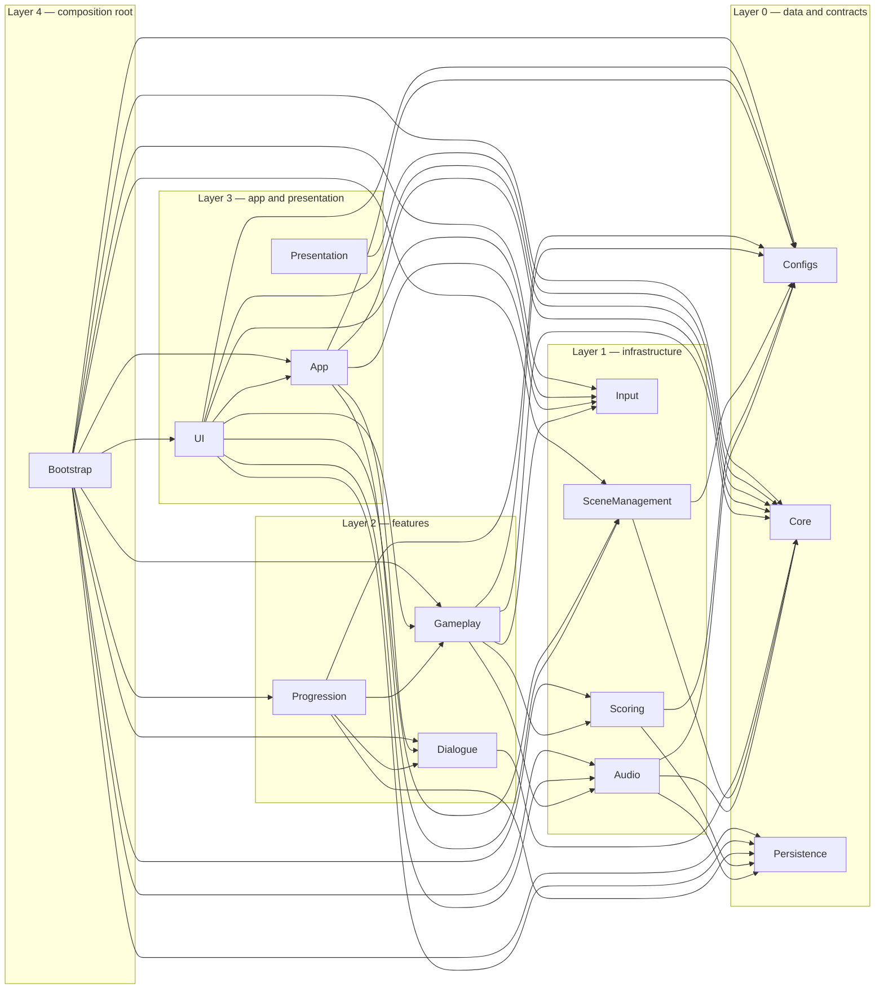

# DreamVille

A cozy third-person shooter built with Unity 6 (URP): pillows ricochet off walls into
runaway "nightmare" enemies, townsfolk NPCs react and talk back, and lobbies open the
way into the next level.

DreamVille started as a small team project (gameplay, art and level content are the
team's; folder names such as `Scenes/Max` still carry that history). It is now being
reworked, solo, into a portfolio piece: layered assemblies,
a Zenject composition root, centralised persistence, data-driven scene identity, and an
EditMode test suite. The gameplay content is the team's work; the architecture
refactor documented below is the author's.

## Screenshots

<!-- TODO: gameplay GIF and screenshots -->

## Highlights

- **Composition root with a fixed set of entry points.** `ProjectContext` binds
  app-lifetime services; `GameStart` installs only the intro bootstrap; one shared
  [`GameplaySceneContext.prefab`](Assets/_Project/Prefabs/Bootstrap/GameplaySceneContext.prefab)
  wires every gameplay scene; `MainMenuContext.prefab` wires the menu. Every service is
  bound by interface (`Container.BindInterfacesTo<T>()`), so consumers depend on
  `IScoreService`, `IPillowThrower`, `IEnemyRegistry` — never a concrete type. See
  [ADR 0001](Docs/adr/0001-zenject-composition-root.md).
- **Layered, acyclic assembly graph.** 14 runtime `.asmdef`s (`Configs`, `Core`,
  `Persistence`, `Input`, `Audio`, `Scoring`, `SceneManagement`, `Gameplay`, `Dialogue`,
  `Progression`, `App`, `UI`, `Presentation`, `Bootstrap`), every reference pointing from
  a feature toward the infrastructure it needs, never back. 13 of the 14 set
  `"autoReferenced": false` (`Bootstrap`, the composition root, is the one exception),
  and only `Presentation` links the render pipeline.
  See [ADR 0002](Docs/adr/0002-assembly-layering.md).
- **A composed player.** `Character.prefab` carries a Zenject `GameObjectContext` whose
  [`PlayerInstaller`](Assets/_Project/Scripts/Gameplay/Player/PlayerInstaller.cs)
  constructs movement, gravity, jump, look, knockback and hit recovery as plain,
  unit-tested classes; [`PlayerMotor`](Assets/_Project/Scripts/Gameplay/Player/PlayerMotor.cs)
  moves the body exactly once per frame, and one allocation-free ground query feeds
  both movement and respawn.
- **One persistence seam.** Every save read/write goes through
  [`ISaveStorage`](Assets/_Project/Scripts/Persistence/ISaveStorage.cs) and two
  repositories (`IProgressRepository`, `IAudioSettingsRepository`); key formats are
  frozen in [`SaveKeys`](Assets/_Project/Scripts/Persistence/SaveKeys.cs) so nobody
  spells out a `PlayerPrefs` key by hand. See
  [ADR 0003](Docs/adr/0003-persistence-abstraction.md).
- **Data-driven scene identity.** `SceneCatalog` and `LevelDefinition` assets are the
  only place a scene name or level id is spelled out — no build indices, no scene-name
  string literals in code. See [ADR 0004](Docs/adr/0004-scene-catalog-and-async.md).
- **UniTask with cancellation, not coroutines**, in the refactored modules: bullet
  lifetime, pillow recall, NPC reactions and scene loading each own a
  `CancellationToken` tied to the object's lifetime.
- **189 EditMode tests**, including a scene-composition guard
  ([`SceneCompositionTests`](Assets/_Project/Tests/EditMode/Composition/SceneCompositionTests.cs))
  that opens every build scene and checks its installers and catalog references, and
  prefab tests that pin the player's composition, so a mis-wired scene fails a test run
  instead of a play session.

## Architecture



`ProjectContext` (installed by `ProjectInstaller`) holds services that outlive a scene:
the scene catalog, audio config and service, the scene loader, and the three
persistence bindings. Each of the six gameplay scenes carries the same
`GameplaySceneContext.prefab` (`SceneServicesInstaller`, `CombatInstaller`,
`GameplayInstaller`, `ProgressionInstaller`, `UiInstaller`); the menu scene carries
`MainMenuContext.prefab`. Runtime flow: `GameStart` plays the intro, then
`GameBootstrap` loads the scene `SceneCatalog` names as the main menu; a menu button
resolves a `LevelDefinition` and asks `ISceneLoader` to load it by scene name.

Full decision records: [ADR 0001 — Zenject composition root](Docs/adr/0001-zenject-composition-root.md),
[ADR 0002 — assembly layering](Docs/adr/0002-assembly-layering.md),
[ADR 0003 — persistence abstraction](Docs/adr/0003-persistence-abstraction.md),
[ADR 0004 — scene catalog and UniTask for gameplay async](Docs/adr/0004-scene-catalog-and-async.md).

## Where to look first

- [`Assets/_Project/Scripts/Bootstrap/ProjectInstaller.cs`](Assets/_Project/Scripts/Bootstrap/ProjectInstaller.cs) — the app-lifetime composition root: every project-scope interface binding in one file.
- [`Assets/_Project/Prefabs/Bootstrap/GameplaySceneContext.prefab`](Assets/_Project/Prefabs/Bootstrap/GameplaySceneContext.prefab) — the one installer set shared by all six gameplay scenes.
- [`Assets/_Project/Scripts/SceneManagement/SceneLoader.cs`](Assets/_Project/Scripts/SceneManagement/SceneLoader.cs) — UniTask scene loading with a concurrent-transition guard and progress events.
- [`Assets/_Project/Scripts/Progression/LevelDirector.cs`](Assets/_Project/Scripts/Progression/LevelDirector.cs) — level completion as a plain class: no MonoBehaviour, no `Update` polling.
- [`Assets/_Project/Scripts/Gameplay/Enemies/States/EnemyStateMachine.cs`](Assets/_Project/Scripts/Gameplay/Enemies/States/EnemyStateMachine.cs) — guarded enemy state machine; [`Enemy.cs`](Assets/_Project/Scripts/Gameplay/Enemies/Enemy.cs) is the thin MonoBehaviour context its seven states see through `IEnemyContext`, and `EnemyConfig` assets hold the archetype tuning.
- [`Assets/_Project/Scripts/Gameplay/Player/PlayerInstaller.cs`](Assets/_Project/Scripts/Gameplay/Player/PlayerInstaller.cs) — the player prefab's own composition root (`GameObjectContext`); [`PlayerMotor.cs`](Assets/_Project/Scripts/Gameplay/Player/PlayerMotor.cs) shows the fixed per-frame order.
- [`Assets/_Project/Scripts/Gameplay/Weapons/Pillow/PillowThrowHandler.cs`](Assets/_Project/Scripts/Gameplay/Weapons/Pillow/PillowThrowHandler.cs) — throw, recall and freeze logic behind the game's core mechanic, driven by UniTask with per-object cancellation.
- [`Assets/_Project/Scripts/Persistence/ProgressRepository.cs`](Assets/_Project/Scripts/Persistence/ProgressRepository.cs) — the only place stars and completion are read from or written to a save.
- [`Assets/_Project/Scripts/Audio/AudioService.cs`](Assets/_Project/Scripts/Audio/AudioService.cs) — saved volume plus per-scene music, driven by the scene catalog.
- [`Assets/_Project/Tests/EditMode/Composition/SceneCompositionTests.cs`](Assets/_Project/Tests/EditMode/Composition/SceneCompositionTests.cs) — opens every build scene and asserts its composition against the catalog.

## Tech stack

| Area | Choice |
|---|---|
| Engine | Unity 6000.3.24f1 LTS, Universal Render Pipeline 17.3 |
| Dependency injection | Zenject / Extenject 9.2 (`ProjectContext` + per-scene `SceneContext`) |
| Async | UniTask 2.5 |
| Input | Unity Input System |
| Camera | Cinemachine 3 |
| Localization | Unity Localization (English, Russian) |

## Project layout

```
Assets/_Project/
  Scripts/        one assembly per module: App, Audio, Bootstrap, Configs, Core,
                   Dialogue, Gameplay, Input, Persistence, Presentation,
                   Progression, SceneManagement, Scoring, UI
  Scenes/         GameStart -> MainMenu -> Lobby_01, Level_01, Level_02, Lobby_02,
                   Level_03, Level_04 (Scenes/Max/* are excluded work-in-progress)
  Prefabs/        Bootstrap (SceneContext prefabs), gameplay and UI prefabs
  Settings/       ScriptableObject configs: Levels/ (SceneCatalog, LevelDefinition),
                   Score/, Audio/, Bullet/, Movement/, Rendering/
  Characters/     player, skins, enemies, NPCs
  Art/ Audio/ Animations/ Environment/ Localization/
  Tests/EditMode/ NUnit tests, one folder per module, fakes in Tests/EditMode/Fakes
```

## Running

Open the project with Unity `6000.3.24f1`, open
[`Assets/_Project/Scenes/GameStart.unity`](Assets/_Project/Scenes/GameStart.unity) and
press Play.

## Tests

Window → General → Test Runner → EditMode → Run All. 189 tests, all green. PlayMode
tests and CI are not set up yet.

## Status and roadmap

**Done:** repository hygiene (dead code, `_Legacy` and unused packages removed);
critical gameplay fixes (bullet pool, enemy death, saved volume, dialogue re-entrancy,
pillow throw/recall); layered, acyclic assemblies with `autoReferenced: false`;
services bound by interface; persistence behind `ISaveStorage`/repositories; data-driven
scene and level identity (`SceneCatalog`/`LevelDefinition`); an `IAudioService` behind
the composition root; one enemy state machine driven by `EnemyConfig` assets, with
pooled projectiles, in place of four separate enemy scripts; a player composed through
a `GameObjectContext` with its damage vignette split into a `Presentation` assembly;
189 EditMode tests; four ADRs.

**Next:** weapon cooldowns and pillow settings behind `IWeapon`; a single
interaction channel for interactables; UI presenters beyond `GameplayPresenter`; CI with
game-ci; a playable build.

## Documentation

[`Docs/README.md`](Docs/README.md) indexes everything under `Docs/`. Architecture
decisions: [`Docs/adr/`](Docs/adr/README.md).
